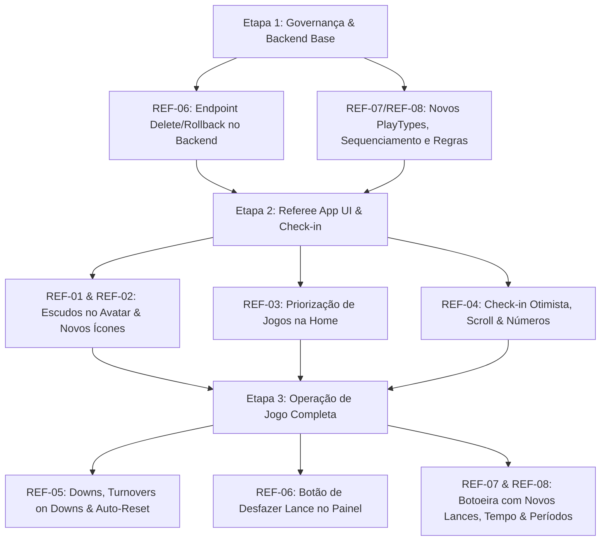

# Plano de Implementação: Melhorias e Correções do Referee App (Flag Platform)

## Objetivo
Estruturar o ciclo completo de correções, melhorias ergonômicas e regras de negócio para o **Referee App** (`flag_referee_app`) e seus impactos no backend (`flag_backend`), centralizando o rastreamento na governança oficial em `flag_platform_docs/_planning/repos/referee_app/` sob o prefixo **`REF`**.

---

## 1. Mapeamento de Issues (Governança `REF`)

Seguindo a governança do projeto ([AGENTS.md](file:///C:/Projetos/America/AGENTS.md) e `flag_platform_docs/_planning/`), criaremos o tracker `_planning/repos/referee_app/` com as seguintes issues formais:

| ID | Área | Título | Tipo | Repos Afetados |
|---|---|---|---|---|
| **REF-01** | Geral | Substituição de fotos por escudos nos avatares & remoção de containers dos ícones | design / ui | `flag_referee_app` |
| **REF-02** | Geral | Catálogo e revisão semântica de ícones para todos os registros de jogadas | design / ui | `flag_referee_app` |
| **REF-03** | Home | Priorização e ordenação estrita dos jogos por status operacional | feature / ux | `flag_referee_app` |
| **REF-04** | Check-in | Check-in otimista imediato, resolução de loop de scroll, exibição de número cadastrado e filtro de elenco por modalidade | bug / perf | `flag_referee_app`, `flag_backend` |
| **REF-05** | Operação | Gestão de downs sequencial, turnovers on downs e auto-reset de controles | regra / ux | `flag_referee_app` |
| **REF-06** | Operação | Rollback confiável e descarte instantâneo de jogadas no painel com estorno de pontuação | feature / bug | `flag_referee_app`, `flag_backend` |
| **REF-07** | Operação | Novos tipos de jogada: Kickoff/Retorno, FG Errados/Bloqueados, Toss, Faltas Duplas, Atitude Antidesportiva, Ejeção, Snap Ruim e 2-Min Warning | regra / api | `flag_referee_app`, `flag_backend` |
| **REF-08** | Operação | Registro de tempo, períodos (Início/Fim), revisão de jogadas e estabilidade da ordenação temporal | bug / feature | `flag_referee_app`, `flag_backend` |

---

## 2. Diagnóstico & Inventário Atual dos Ícones de Jogadas

### A. Situação Atual no Código (`play_pad_widget.dart` / `play_dialog.dart`)
Atualmente, o sistema atribui **um único ícone genérico por categoria**, repetindo-o para todas as jogadas e encapsulando cada botão em um container opaco com borda:

```
[ Container Box ] -> [ Ícone Genérico Repetido ] -> [ Rótulo da Jogada ]
```

| Categoria | Ícone Atual no Código | Jogadas que usam esse mesmo ícone | Incoerência Identificada |
|---|---|---|---|
| **Pontuação (`score`)** | `Icons.emoji_events` (Troféu) | • Touchdown (+6)<br>• Ponto Extra (+1)<br>• Ponto Extra (+2)<br>• Pick Two (+2)<br>• Safety (+2)<br>• Field Goal (+3)<br>• Pick Six (+6)<br>• Mini Touchdown (+2) | Um troféu é atribuído indiscriminadamente a lances simples (XP de 1 ponto) e lances defensivos (Safety/Pick Two). |
| **Ataque (`offense`)** | `Icons.sports_football_outlined` (Bola oval genérica) | • Passe Completo<br>• Passe Incompleto<br>• Corrida<br>• First Down | Todos os tipos de avanço e passes usam exatamente o mesmo ícone. Não há distinção entre passe, passe incompleto e corrida. |
| **Defesa (`defense`)** | `Icons.security` (Escudo de proteção) | • Retirada de Fita<br>• Derrubada (Tackle)<br>• Sack<br>• Passe Desviado<br>• Interceptação | Um escudo genérico serve tanto para um passe desviado quanto para uma interceptação ou sack no quarterback. |
| **Especial (`specialTeams`)** | `Icons.unfold_more` (Duas setas verticais) | • Punt<br>• Kickoff | Ícone completamente abstrato de expansão/setas que não comunica chute, chute de devolução ou saída de bola. |
| **Faltas (`penalty`)** | `Icons.warning_amber_rounded` (Triângulo de alerta) | • Falta genérica | Triângulo genérico de trânsito em vez de bandeira de arbitragem / flag ou falta esportiva. |

### B. Proposta de Ícones Específicos & Desencapsulamento
- **Fim dos containers pesados**: os botões de ação e lances passam a ser chips/botões limpos com fundo flat ou outline esportivo.
- **Ícones semânticos dedicados por jogada**:
  - `TOUCHDOWN`: `Icons.sports_score` ou `Icons.stars` (Destaque máximo esportivo)
  - `EXTRA_POINT_1` / `EXTRA_POINT_2`: `Icons.plus_one` / `Icons.exposure_plus_2`
  - `SAFETY` / `PICK_TWO`: `Icons.shield_outlined` / `Icons.swap_horiz`
  - `FIELD_GOAL`: `Icons.expand_less` / trave estilizada
  - `PASS` (Completo): `Icons.near_me` (Trajetória de passe para frente)
  - `INCOMPLETE_PASS`: `Icons.close` / `Icons.block` (Passe abortado/caiu no chão)
  - `RUN`: `Icons.directions_run` (Atleta em corrida)
  - `FIRST_DOWN`: `Icons.flag` / `Icons.double_arrow` (Conquista de nova marcação)
  - `FLAG_PULL`: `Icons.content_cut` ou `Icons.remove_circle_outline` (Puxada de fita)
  - `SACK`: `Icons.gavel` ou `Icons.back_hand` (Queda do passador atrás da linha)
  - `DEFLECTION`: `Icons.pan_tool_outlined` (Mão espalmada bloqueando a bola)
  - `INTERCEPTION`: `Icons.change_circle` / `Icons.sync_alt` (Troca de posse pelo ar)
  - `PUNT` / `KICKOFF`: `Icons.sports_martial_arts` / `Icons.arrow_upward` (Chute longo para frente)
  - `PENALTY`: `Icons.flag_circle` (Bandeira amarela esportiva)

---

## 3. Diagnóstico e Arquitetura por Módulo

### A. Geral (REF-01 e REF-02)
1. **Avatar dos Atletas (`AthleteCheckInCard`, `KicksterAvatar`)**:
   - Como não há fotos individuais de atletas no cadastro da plataforma, o componente deve exibir o **escudo da equipe** (`KicksterTeamShield`) no container circular/hexagonal, com o badge de camisa `#N` sobreposto no canto inferior direito.
2. **Remoção de Containers**:
   - Eliminar a caixa retangular extra que envelopa ícone + texto, reduzindo ruído visual e melhorando o toque no tablet/mobile.

---

### B. Home do Árbitro (REF-03)
**Regra de Priorização Estrita ao abrir a tela:**
Em `referee_home_screen.dart`, unificar os jogos de todas as rodadas do torneio selecionado ordenados pela seguinte esteira operacional:
1. **`IN_PROGRESS` (Ao vivo em andamento)**: no topo absoluto com status pulsante e botão direto *"Operar Jogo"*.
2. **`OPEN` (Aberto para Check-in / Iniciar)**: jogos liberados pela mesa para validação de atletas ou aguardando apito inicial.
3. **`CONFERENCE` (Em Conferência)**: jogos concluídos no campo aguardando assinatura e fechamento de súmula.
4. **`FINISHED` (Encerrados recentes)**: partidas do dia já concluídas.
5. **Últimos 5 jogos passados**: limite de histórico para evitar sobrecarga de lista e poluição visual.

---

### C. Check-in de Atletas (REF-04)
1. **Toggle Otimista Imediato (Offline-First / Zero Latência)**:
   - *Problema*: `_handleTogglePresence` aguarda o retorno da API HTTP e depois invalida o provider. Se a conexão em campo estiver oscilando (3G/4G), o toggle congela.
   - *Solução*: O estado local do check-in no ViewModel atualiza **instantaneamente** ao toque (mutação otimista na memória). A sincronização com a API roda em background com fila de retry e feedback não-bloqueante.
2. **Loop de Scroll Infinito**:
   - *Problema*: `AppRefreshable(scrollable: true, child: SingleChildScrollView(...))` aninhado com reconstrução incondicional dos cards a cada build sem `Key` estável nos widgets de atleta (`AthleteCheckInCard`).
   - *Solução*: Migrar para `ListView.builder` virtualizado com chaves explícitas `ValueKey(item.athleteId)`.
3. **Exibição do Número Cadastrado**:
   - *Problema*: O número oficial cadastrado só aparecia se houvesse override (`hasOverride == true`).
   - *Solução*: Destacar de forma permanente o número oficial `#${checkIn.athleteNumber}` no título do card ao lado do nome do atleta.
4. **Filtro de Elenco por Modalidade (5x5, 8x8, etc.)**:
   - Exibir na lista apenas os atletas elegíveis/inscritos para a categoria e formato da competição (respeitando limite de elenco do torneio).

---

### D. Operação do Jogo (REF-05 a REF-08)

#### 1. Controle de Descidas (Downs) e Turnovers on Downs
- **Controle Sequencial**:
  - `1ª para a linha` → jogada comum → `2ª descida` → jogada comum → `3ª descida` → jogada comum → `4ª descida`.
  - Se na 4ª descida a equipe não conquistar o First Down nem pontuar: registrar automaticamente **Turnover on Downs**, inverter a posse e resetar para 1ª descida da outra equipe.
- **Zerar Controles (Clean State)**:
  - Após o registro de qualquer jogada no painel, resetar automaticamente seletores de jardas, atletas e seletores secundários para o estado padrão limpo.

#### 2. Rollback Confiável & Ação Rápida no Painel
- *Problema Atual*: O backend não possui endpoint para deletar/desfazer lance (`PlayApi.java` só possui GET, POST e PATCH). O árbitro não consegue anular um lance lançado errado.
- *Solução Arquitetural*:
  1. **Backend**: Implementar `DELETE /api/v1/games/{gameId}/plays/{playId}` (e opcionalmente `DELETE /api/v1/games/{gameId}/plays/last`).
     - Reverter pontos do placar do jogo caso o lance tenha adicionado pontuação.
     - Remover o `ScoreEvent` correspondente.
     - Publicar evento para sincronização com Firestore / Live App.
  2. **Referee App**: Botão *"Desfazer último lance"* com confirmação de 1 toque no topo da timeline de operação.

#### 3. Novos Tipos de Jogadas no Catálogo (`PlayType` + Backend)
Adicionar ao `PlayType` e backend:
- **Kickoff & Retorno**: registrar ponto de início do chute e ponto de chegada do retorno (ou marcar `Touchback` para início automático na linha padrão de 20 jardas).
- **Field Goal Não Convertido**:
  - `FIELD_GOAL_MISSED` (Erro / Para fora).
  - `FIELD_GOAL_BLOCKED` (Bloqueado pela defesa).
- **Passe Toss**: jogada lateral/pitch de corrida.
- **Faltas Duplas (`DOUBLE_PENALTY`)**: faltas simultâneas de ambos os times (anulação do lance e repetição da descida).
- **Falta com Perda de Descida vs Repetição**: flag na falta determinando se consome a descida ou repete.
- **Conduta Antidesportiva (`UNSPORTSMANLIKE_CONDUCT`)**.
- **Ejeção / Desqualificação (`EJECTION`)**: registro formal de expulsão de atleta/membro da comissão.
- **Snap Ruim (`BAD_SNAP`)**: perda de jardas pelo snap falho.
- **Aviso de 2 Minutos (`TWO_MINUTE_WARNING`)**: paralisação oficial do relógio no final do tempo.
- **Início e Término de Período**: eventos de `PERIOD_START` e `PERIOD_END` (1Q, 2Q, Halftime, 3Q, 4Q, OT).
- **Revisão de Jogada (`PLAY_REVIEW`)**: anotação de desafio ou revisão de arbitragem.

#### 4. Registro de Tempo e Ordenação Estável
- **Registro do Relógio**: campo de tempo no formato `MM:SS` em todas as jogadas.
- **Ordenação Confiável**:
  - Adicionar ao modelo `Play` um campo `sequenceNumber` sequencial gerado pelo backend (ou ordenação `ORDER BY createdAt DESC, id DESC`), eliminando a flutuação ao sair e voltar da tela.

---

## 4. Cronograma de Execução Sugerido



---

## 5. Próximos Passos
1. Validar e aprovar a lista de ícones propostos e o escopo das novas jogadas.
2. Criar a estrutura oficial em `flag_platform_docs/_planning/repos/referee_app/` com as issues `REF-01` a `REF-08`.
3. Iniciar a execução pela **Etapa 1** (Backend: Delete/Rollback de jogadas e novos enums de `PlayType`).
