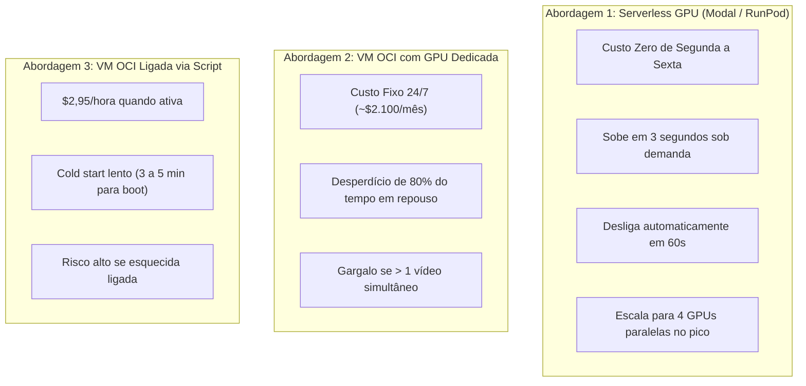

# Análise Comparativa de Custos e Infraestrutura: Serverless GPU vs. OCI sob Demanda

> **Documento Oficial de Arquitetura & FinOps**  
> **Status:** Aprovado / Baseline de Produção  
> **Aplica-se a:** `flag_vision_service`, `flag_backend`, `flag_platform_infra`  
> **Data:** Novembro de 2026  
> **Tracker:** [`_planning/extracao-video-jogadas/map.md`](../_planning/extracao-video-jogadas/map.md) · ID: `VID-06`

---

## 1. Contexto e Perfil de Carga do Flag Football

A operação esportiva de campeonatos de Flag Football (5x5, 8x8) e Futebol Americano apresenta um comportamento de demanda altamente sazonal e concentrado:
- **Padrão Temporal:** 90% das partidas ocorrem em finais de semana (sábados e domingos), durante torneios regionais e etapas de circuitos estaduais/nacionais.
- **Ociosidade Semanal:** De segunda a sexta-feira, o volume de processamento de novos vídeos é próximo de **zero**.
- **Duração do Vídeo:** Uma transmissão completa no YouTube varia de **1h45 a 2h00** (aproximadamente 7.200 segundos).
- **Parâmetros Otimizados de IA (Fase 0):**
  - Resolução travada em **720p HD** (1280x720).
  - Amostragem decrescida para **10 FPS** (Frames Por Segundo).
  - Total de frames por partida de 2h:
    $$7.200 \text{ s} \times 10 \text{ FPS} = 72.000 \text{ frames}$$
- **Pico de Concorrência:** Até **4 partidas submetidas simultaneamente** ao final de uma rodada de torneio.

---

## 2. Tempo Real de Inferência em GPU

Utilizando o modelo **Ultralytics YOLOv8 Nano** (`yolov8n.pt`) ou **Small** (`yolov8s.pt`) com o rastreador **ByteTrack**:

| Hardware GPU | Velocidade de Inferência (720p) | Tempo para 72.000 frames (Jogo 2h) | Fator de Aceleração |
|---|:---:|:---:|:---:|
| **CPU Tradicional (4 vCPU VM OCI)** | ~4 a 6 FPS | 3,5 a 5 horas | $0.5\times$ (muito lento) |
| **NVIDIA T4 (16GB VRAM)** | ~120 a 150 FPS | **8 a 10 minutos** | $\sim 13\times$ mais rápido que tempo real |
| **NVIDIA L4 (24GB Ada Lovelace)** | ~220 a 280 FPS | **4 a 5 minutos** | $\sim 26\times$ mais rápido que tempo real |
| **NVIDIA A10G / RTX 4090** | ~300+ FPS | **3 a 4 minutos** | $\sim 35\times$ mais rápido que tempo real |

> **Conclusão Técnica:** Uma GPU moderna precisa de apenas **8 a 10 minutos** de processamento ativo para analisar um jogo completo de 2 horas.

---

## 3. Matriz Comparativa entre Provedores e Modelos

### Detalhamento Financeiro e de Recursos:

| Critério | **Modal.com (Serverless)** | **RunPod Serverless** | **OCI GPU sob Demanda (`VM.GPU.A10.1`)** | **OCI VM Dedicada Contínua** |
|---|---|---|---|---|
| **Modelo de Cobrança** | Por segundo de execução | Por segundo de execução | Por hora de VM provisionada | Por mês contínuo (24/7) |
| **Preço/Hora GPU T4 / L4** | **US$ 0,59/h** (T4) / **US$ 0,80/h** (L4) | **US$ 0,44/h** (RTX 3090) / **US$ 0,50/h** (L4) | N/A (A10: **US$ 2,95/h**) | A10: **US$ 2,95/h** |
| **Custo por Jogo de 2h (~8 min)** | **US$ 0,078** (~R$ 0,45) | **US$ 0,058** (~R$ 0,33) | **US$ 0,49** (~R$ 2,80) | N/A |
| **Custo Fixo Mensal em Repouso** | **US$ 0,00** | **US$ 0,00** | **US$ 0,00** (se desligada) | **~US$ 2.124,00 / mês** |
| **Tempo de Inicialização (Cold Start)** | **2 a 4 segundos** | **5 a 15 segundos** | **3 a 5 minutos** (boot OCI) | 0 segundos (já ligada) |
| **Escala em Pico (4 vídeos)** | **4 GPUs paralelas instantâneas** | **4 GPUs paralelas instantâneas** | Fila sequencial (ou ligar 4 VMs) | Fila sequencial de 40 min |
| **Risco Operacional de Esquecimento** | **Zero** (auto-shutdown 60s) | **Zero** (auto-shutdown 60s) | **Alto** (se esquecer ligada) | Custo fixo astronômico |

---

## 4. Simulação de Cenários de Uso Real

Considerando uma taxa de câmbio média de US$ 1,00 = R$ 5,75:

### Cenário A: Etapa de Torneio Regional (10 Jogos / Mês)
- **Modal.com:** $10 \text{ jogos} \times \$0,078 = \mathbf{\$0,78\text{/mês}}$ (**~R$ 4,50 / mês**)
- **RunPod:** $10 \text{ jogos} \times \$0,058 = \mathbf{\$0,58\text{/mês}}$ (**~R$ 3,35 / mês**)
- **OCI sob Demanda:** 10 jogos $\times$ 15 min = 2,5 horas de VM = **US$ 7,37 / mês** (~R$ 42,00 / mês)

### Cenário B: Campeonato Nacional / Circuito Regular (40 Jogos / Mês)
- **Modal.com:** $40 \text{ jogos} \times \$0,078 = \mathbf{\$3,12\text{/mês}}$ (**~R$ 17,90 / mês**)
- **RunPod:** $40 \text{ jogos} \times \$0,058 = \mathbf{\$2,32\text{/mês}}$ (**~R$ 13,30 / mês**)
- **OCI sob Demanda:** ~10 horas ativas no mês = **US$ 29,50 / mês** (~R$ 170,00 / mês)

### Cenário C: Escala Plena / Temporada Completa (100 Jogos / Mês)
- **Modal.com:** $100 \text{ jogos} \times \$0,078 = \mathbf{\$7,80\text{/mês}}$ (**~R$ 44,80 / mês**)
- **RunPod:** $100 \text{ jogos} \times \$0,058 = \mathbf{\$5,80\text{/mês}}$ (**~R$ 33,30 / mês**)
- **OCI sob Demanda:** ~25 horas de GPU = **US$ 73,75 / mês** (~R$ 424,00 / mês)

---

## 5. Recomendação Arquitetural Oficial

> [!TIP]
> **Decisão Consolidada:** Utilizar **Serverless GPU via [Modal.com](https://modal.com)** como infraestrutura primária da **Fase 0**, com fallback para **RunPod Serverless**.

### Justificativas da Decisão:
1. **Economia Extrema (Pay-per-Play):** O custo médio de processamento por jogo de 2 horas fica abaixo de **R$ 0,50**, eliminando despesas de infraestrutura ociosa durante a semana.
2. **Eliminação de Risco Operacional:** O `scaledown_window=60` desliga o container e a GPU exatamente 1 minuto após o término do processamento, evitando contas imprevistas causadas por esquecimento humano.
3. **Elasticidade em Pico sem Fila:** Quando 4 vídeos são submetidos no domingo às 18h, o Modal provisiona 4 instâncias T4 em paralelo em menos de 5 segundos. Todos os 4 jogos são entregues via Webhook ao backend Java em aproximadamente 10 minutos.
4. **Deploy Nativo em Python:** O script [`modal_app.py`](../../flag_vision_service/modal_app.py) deploya a aplicação inteira com um único comando (`modal deploy modal_app.py`), sem necessidade de gerenciar Kubernetes, drivers NVIDIA CUDA ou instâncias complexas na nuvem.
