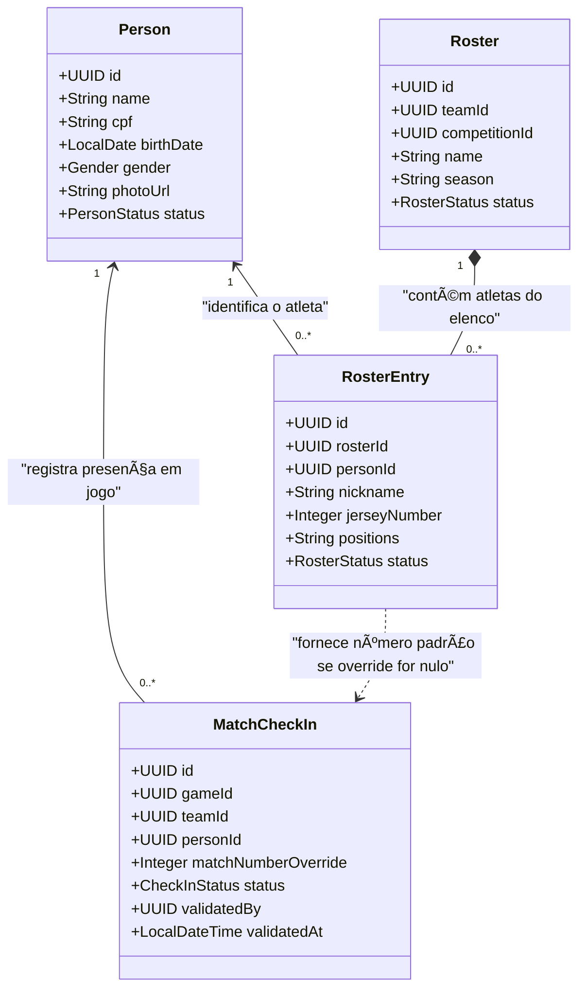
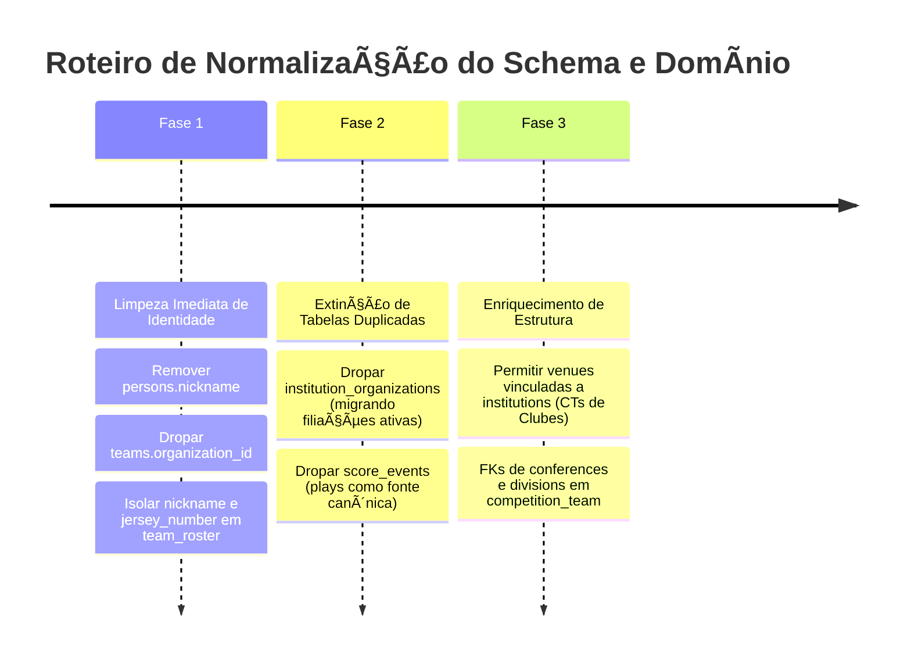

# Análise Profunda: Resolução de Conflitos, Incoerências e Fronteiras de Todas as Tabelas do Modelo

> **Projeto:** Flag Platform (Ecossistema America)  
> **Data:** 30 de Outubro de 2026  
> **Autoridade Arquitetural:** ADR-001, Domain-Driven Design (DDD) & Modulith  
> **Status:** Fase 1 Concluída e Publicada em Staging (Liquibase 020 Ativo)  

---

## 1. Visão Executiva e Diagnóstico Fundacional

O modelo de dados atual da Flag Platform reflete o crescimento orgânico da plataforma: iniciou com um schema simplificado (onde entidades de federação gerenciavam tudo diretamente) e evoluiu com a introdução do conceito formal de **Agremiação (`institutions`)**, **Súmula Eletrônica (`plays`)** e **Filiação Anual (`institution_affiliations`)**.

Entretanto, esse crescimento acumulou **conflitos conceituais graves**, atributos alocados em tabelas incorretas, violações de escopo e duplicações estruturais que violam as fronteiras dos *Bounded Contexts* do esporte:

```mermaid
flowchart TD
    subgraph Erros["Anomalias Estruturais Críticas"]
        E1["`persons.nickname` — Apelido esportivo forçado na certidão de pessoa civil"]
        E2["`teams.organization_id` — Time vinculado à Federação em vez de pertencer à Agremiação"]
        E3["Número e Posições do Atleta — Risco de poluição da identidade civil em vez de isolamento no Roster"]
        E4["Duplicidade N:N: `institution_organizations` vs `institution_affiliations`"]
        E5["Duplicidade de Timeline: `score_events` vs `plays`"]
        E6["`persons.role` — Papel esportivo rígido engessando uma pessoa física com múltiplos papéis"]
        E7["`venues.organization_id` — Praças esportivas restritas a Federações, ignorando CTs de Clubes"]
        E8["`competition_team` — Conferência e Divisão gravadas como strings soltas desconectadas de conferences e divisions"]
    end

    subgraph Contextos["Fronteiras Canônicas do Domínio (DDD)"]
        C1["Identidade Civil: persons"]
        C2["Governança Federativa: organizations & institution_affiliations"]
        C3["Estrutura Clubística: institutions, teams & venues"]
        C4["Competições: competitions, rounds, conferences, divisions & competition_team"]
        C5["Elencos e Atletas: rosters & team_roster (roster_entries)"]
        C6["Operação de Jogo: games, checkins, game_participants & plays"]
    end

    E1 -.->|Violou| C1
    E2 -.->|Violou| C3
    E3 -.->|Violou| C5
    E4 -.->|Violou| C2
    E5 -.->|Violou| C6
    E6 -.->|Violou| C1
    E7 -.->|Violou| C3
    E8 -.->|Violou| C4
```

---

## 2. Análise Detalhada dos Conflitos por Bounded Context

### 2.1 Contexto de Identidade Civil vs Contexto de Elenco Esportivo

#### Conflito A: `nickname` em `persons` (Atributo Esportivo Forçado na Pessoa Civil)
- **O Problema:** A tabela `persons` representa a **pessoa física civil** (portadora de CPF único, nome civil completo, data de nascimento e foto de documento).
- **A Incoerência:** Nem toda pessoa física no ecossistema é atleta em campo: existem **Árbitros (`REFEREE`)**, **Comissários (`COMMISSIONER`)**, **Delegados de Partida (`DELEGATE`)**, **Mesários (`SCORER`/`TIMEKEEPER`)**, **Presidentes de Clube** e **Treinadores (`COACH`)**. Nenhum árbitro ou delegado possui ou deve possuir "apelido de jogo" no seu cadastro civil.
- **Solução Canônica:** O apelido esportivo pertence exclusivamente a **`team_roster.nickname`**. A tabela `persons` deve conter apenas dados civis: `name`, `cpf`, `birth_date`, `gender`, `photo_url`, `status`.

#### Conflito B: Número da Camisa (`jersey_number`) Isolado Exclusivamente no Roster
- **O Problema:** O número da camisa que o atleta veste em campo (`jersey_number` / `number`) é uma atribuição **100% esportiva e temporal**, associada à inscrição do jogador em uma determinada equipe para uma temporada.
- **Regras Fundamentais de Domínio:**
  1. **Pertence estritamente ao Roster:** O número padrão da camisa pertence à tabela **`team_roster.jersey_number`**. NUNCA deve existir em `persons`.
  2. **Multi-Equipe e Troca de Número:** Um mesmo atleta civil (CPF X) pode jogar com a camisa `#10` no time A e, se for transferido ou jogar em outra modalidade, vestir a camisa `#7` no time B.
  3. **Override Temporário de Partida (`checkins.match_number`):** No dia de uma partida específica, se o atleta precisar utilizar uma camisa reserva (ex.: uniforme rasgado ou duplicidade acidental no jogo), o campo `checkins.match_number` funciona estritamente como *game override* temporário, **sem alterar o número oficial cadastrado no elenco** (`team_roster.jersey_number`).

#### Conflito C: Posições do Atleta (`positions`)
- **O Problema:** Posições em campo (ex.: `QB`, `WR`, `DB`, `C`, `RUSH`) são específicas de cada equipe e tática.
- **Histórico e Correção:** No passado, a migration `015-add-positions-to-persons.yaml` tentou adicionar `positions` à tabela `persons`, o que se provou um erro conceitual e foi revertido na migration `016-drop-positions-from-persons.yaml`. A autoridade exclusiva de posições é **`team_roster.positions`**.

#### Conflito D: `persons.role` Rígido em Cadastro de CPF Único
- **O Problema:** A tabela `persons` possui uma coluna `role NOT NULL` (`ATHLETE`, `COACH`, `TECHNICAL_STAFF`, `REFEREE`, `DELEGATE`, `COMMISSIONER`).
- **A Incoerência:** No desporto amador e universitário brasileiro, **o papel de uma pessoa física é contextual**:
  - No sábado de manhã, a pessoa atua como Árbitro Principal (`game_participants`).
  - No domingo à tarde, a mesma pessoa joga como Atleta (`team_roster`) por um clube em outra divisão.
  - Sendo o `cpf` único, o `role` fixo em `persons` bloqueia a pessoa de exercer múltiplos papéis no ecossistema.
- **Solução Canônica:** O papel em `persons` deve ser um papel padrão/preferencial de cadastro (`default_role`), enquanto o papel efetivo é sempre determinado pelo contexto de atuação:
  - Na partida: `game_participants.role` e `game_participants.function`.
  - No elenco: `team_roster`.

---

### 2.2 Contexto de Estrutura Clubística vs Governança Federativa

#### Conflito E: `teams.organization_id` (Quebra da Hierarquia de Propriedade do Clube)
- **O Problema:** Na governança esportiva:
  - **Federação / Liga (`organizations`):** Organiza competições e homologa filiações. Não possui equipes esportivas.
  - **Agremiação / Clube (`institutions`):** Entidade de prática desportiva detentora dos direitos e mantenedora das suas equipes.
  - **Equipe (`teams`):** Pertence **100% à sua Agremiação (`institution_id`)**.
- **A Incoerência:** A tabela `teams` ainda mantém a coluna legada `organization_id` (quase sempre `NULL`), gerando queries duplicadas (`findAllByOrganizationId`) e rotas ambíguas.
- **Solução Canônica:** Dropar a coluna `organization_id` da tabela `teams`. O vínculo de um time com uma Federação se dá pela participação em campeonatos via **`competition_team`** (`competition_id` $\rightarrow$ `competitions.organization_id`).

#### Conflito F: Duplicidade entre `institution_organizations` e `institution_affiliations`
- **O Problema:** Existem duas tabelas ligando Clubes a Federações:
  1. `institution_organizations`: tabela N:N estática e sem auditoria (`institution_id`, `organization_id`).
  2. `institution_affiliations`: modelo rico que governa a filiação oficial anual (`season`, `status`: `PENDING`/`APPROVED`/`REJECTED`, `requested_at`, `reviewed_at`, `rejection_reason`).
- **Solução Canônica:** Dropar a tabela legada `institution_organizations` e unificar toda relação Federação $\leftrightarrow$ Clube exclusivamente em `institution_affiliations`.

#### Conflito G: Praças Esportivas (`venues.organization_id` vs Centros de Treinamento de Clubes)
- **O Problema:** A tabela `venues` possui apenas a coluna `organization_id`.
- **A Incoerência:** Um estádio ou centro de treinamento pode pertencer a um Clube (`institution_id`), ser administrado pela Federação (`organization_id`), ou ser uma praça pública neutra alugada para rodadas duplas. A amarração rígida atual impede agremiações de cadastrarem seus próprios campos mandantes.
- **Solução Canônica:** Permitir que `venues` possua opcionalmente `institution_id` e/ou `organization_id`, ou torná-la uma praça esportiva compartilhável no ecossistema.

---

### 2.3 Contexto de Competições e Agrupamentos

#### Conflito H: `competition_team` (Strings Desnormalizadas vs Tabelas Estruturadas)
- **O Problema:** A tabela `competition_team` grava a alocação do time com colunas de texto soltas:
  - `group_name VARCHAR`
  - `conference_name VARCHAR`
  - `division_name VARCHAR`
- **A Incoerência:** Existem tabelas formais no banco: `conferences` e `divisions`. Se o administrador alterar o nome de uma conferência na tabela mestre, os registros em `competition_team` ficam dessincronizados.
- **Solução Canônica:** Padronizar as chaves estrangeiras (`conference_id`, `division_id`) e manter `group_name` apenas para agrupamentos simples baseados em letras/grupos (`Grupo A`, `Grupo B`).

#### Conflito I: Nomenclatura das Tabelas de Elenco (`rosters` vs `team_roster`)
- **O Problema:**
  - `rosters`: Tabela de cabeçalho do elenco (`team_id`, `competition_id`, `season`, `status`).
  - `team_roster`: Tabela de itens/linhas com os atletas inscritos (`roster_id`, `person_id`, `nickname`, `jersey_number`, `positions`, `status`).
- **A Incoerência:** A tabela de cabeçalho é plural (`rosters`), mas a tabela de itens chama-se `team_roster` (que parece um cabeçalho singular de time).
- **Semântica Canônica:** No nível de classes Java e documentação, o cabeçalho é `Roster` e as entradas são `RosterEntry`.

---

### 2.4 Contexto de Partidas e Linha do Tempo

#### Conflito J: Duplicidade entre `score_events` e `plays`
- **O Problema:**
  - `score_events`: Criado na V1 da plataforma para gravar apenas os eventos que pontuam.
  - `plays`: Tabela completa de súmula eletrônica da partida (jardas, quartos, tempos, faltas, turnovers, conversões de 1 e 2 pontos, touchdowns e safeties).
- **A Incoerência:** Toda vez que um lance é inserido em `plays`, o backend grava uma cópia duplicada resumida em `score_events` via ApplicationEvent.
- **Solução Canônica:** Descontinuar e dropar `score_events`. A tabela canônica para todos os eventos da partida é **`plays`**.

#### Conflito K: `checkins` vs `game_participants`
- **Clareza de Papéis:**
  - `checkins`: Atletas do time escalados na partida (com `team_id`, `person_id`, `match_number` de camisa e status `PRESENT`).
  - `game_participants`: Oficiais neutros da partida (com `game_id`, `person_id`, `role = REFEREE/DELEGATE/COMMISSIONER` e `function = MAIN_REFEREE/SCORER/TIMEKEEPER`).
- **Diagnóstico:** A separação conceitual aqui é correta (atletas pertencem a um time no jogo; oficiais pertencem ao jogo como neutros). Apenas a nomenclatura `checkins` ganha maior clareza quando entendida como `game_roster` / `match_roster`.

---

## 3. Matriz Completa das 25 Tabelas do Ecossistema

A tabela a seguir apresenta a revisão exaustiva de cada entidade do modelo, seu status de coerência e a ação de normalização necessária:

| # | Tabela | Bounded Context | Responsabilidade de Domínio | Incoerência / Conflito Atual | Ação de Normalização |
|---|---|---|---|---|---|
| 1 | **`persons`** | Identidade Civil | Cadastro de pessoa física (CPF, nome civil, nascimento, foto) | Possui `nickname` (que é de atleta) e `role` rígido | **Remover `nickname`**; flexibilizar `role` para atuações contextuais |
| 2 | **`team_roster`** | Elencos | Atletas inscritos no elenco com apelido de jogo, número e posições | Nome da tabela confuso com `rosters` | **Isolar aqui com exclusividade: `nickname`, `jersey_number` e `positions`** |
| 3 | **`rosters`** | Elencos | Cabeçalho do elenco do time (base ou competição) | - | Coerente: vincula `team_id` e opcionalmente `competition_id` |
| 4 | **`teams`** | Estrutura Clubística | Equipe esportiva mantida pelo clube | **Possui `organization_id`** | **Dropar `teams.organization_id`**; time pertence 100% a `institution_id` |
| 5 | **`institutions`** | Estrutura Clubística | Agremiação / Clube (CNPJ, presidente, sede, cores) | - | Coerente: entidade de prática desportiva dona dos times |
| 6 | **`organizations`**| Governança | Federação / Liga esportiva que organiza torneios | - | Coerente: administra campeonatos e homologa filiações |
| 7 | **`institution_affiliations`** | Governança | Filiação anual formal do clube na federação | - | Coerente: possui `season`, `status`, datas de homologação |
| 8 | **`affiliation_windows`** | Governança | Janela temporal para abertura de pedidos de filiação | - | Coerente: governa prazos federativos |
| 9 | **`institution_organizations`** | Governança | Vínculo N:N legado entre clube e federação | **Duplica `institution_affiliations`** sem auditoria ou status | **Dropar tabela `institution_organizations`** |
| 10 | **`competitions`** | Competições | Torneio esportivo gerido pela federação | - | Coerente: modalidade, gênero, formato, temporadas |
| 11 | **`competition_enrollment_windows`** | Competições | Janela de inscrição de equipes no torneio | - | Coerente: prazos de homologação de times |
| 12 | **`competition_team`** | Competições | Inscrição e chaveamento de equipe no torneio | Strings soltas de conferência e divisão | Substituir por FKs `conference_id` e `division_id` |
| 13 | **`conferences`** | Competições | Divisão de conferência no torneio (ex: Metropolis, Caipira) | - | Coerente: estrutura formal de agrupamento |
| 14 | **`divisions`** | Competições | Subdivisão da conferência no torneio | - | Coerente: agrupamento de times |
| 15 | **`rounds`** | Competições | Rodadas regulares e fases de playoffs | - | Coerente: sequenciamento de jogos |
| 16 | **`games`** | Operação de Jogo | Partida entre mandante e visitante | - | Coerente: status, placar, data/hora e local |
| 17 | **`venues`** | Estrutura / Jogos | Praça esportiva / Campo de jogo | **Restrito a `organization_id`**, sem suporte a CT de clube | Adicionar suporte a `institution_id` |
| 18 | **`checkins`** | Operação de Jogo | Presença e escalação de atletas na partida | - | Coerente: `match_number` é override de camisa para o jogo |
| 19 | **`game_participants`**| Operação de Jogo | Equipe neutra de arbitragem e mesa da partida | - | Coerente: isola oficiais com `role` e `function` |
| 20 | **`plays`** | Operação de Jogo | Linha do tempo canônica de todos os lances | - | Coerente: fonte única da verdade para estatísticas e placar |
| 21 | **`score_events`** | Operação de Jogo | Resumo legado de pontuações | **Duplica lances de `plays`** | **Descontinuar e dropar `score_events`** |
| 22 | **`standings`** | Classificação | Tabela consolidada de pontuação e aproveitamento | - | Coerente: terminologia corrigida para `points_for/against` |
| 23 | **`standings_rules`** | Classificação | Critérios de desempate e ranking do torneio | - | Coerente: motor de cálculo de classificação |
| 24 | **`playoff_configurations`** | Classificação | Regras e chaveamento da fase final de playoffs | - | Coerente: estrutura eliminatória |
| 25 | **`users`** | Acesso e Segurança | Contas de login e credenciais na plataforma | - | Coerente: escopo via `organization_id` ou `institution_id` |

---

## 4. O Modelo de Elenco e Atleta Perfeito (Canonical Roster Architecture)

Para responder com precisão máxima ao questionamento sobre os atributos do atleta:



### Por que esta separação é perfeita:
1. **`Person` é universal:** Registra qualquer ser humano (atleta, técnico, árbitro, dirigente) com seus dados civis protegidos.
2. **`RosterEntry` é o avatar esportivo do atleta:** Guarda o **apelido de jogo (`nickname`)**, o **número oficial da camisa (`jerseyNumber`)** e as **posições em campo (`positions`)** específicos daquele time.
3. **`MatchCheckIn` é a súmula em tempo real:** Herda o número padrão do `RosterEntry`, permitindo `matchNumberOverride` caso no dia do jogo ocorra troca temporária de camisa.

---

## 5. Roteiro Fatorado de Execução



### Execução Concluída (Fase 1 — Normalização Canônica):
1. **Migration Liquibase 020 (`020-normalize-schema-persons-teams.yaml`):**
   - Backfill idempotente: qualquer `persons.nickname` residual foi migrado para `team_roster.nickname`.
   - `ALTER TABLE persons DROP COLUMN nickname`.
   - `ALTER TABLE teams DROP CONSTRAINT fk_team_organization` e `DROP COLUMN organization_id`.
   - Aplicado e validado em staging contra o Oracle ADB 23ai.
2. **Refatoração no Backend Java (`flag_backend`):**
   - Removido `nickname` de `PersonEntity`, `PersonInfo`, `PersonResponse`, `CreatePersonRequest`, `UpdatePersonRequest` e `CreatePersonBatchItem`.
   - Removido `organizationId` e `organizationName` de `TeamEntity`, `TeamResponse`, `CreateTeamRequest` e `UpdateTeamRequest`.
   - `TeamRepository` saneado: removidas queries diretas por `organizationId`. A rota legada consulta através das agremiações filiadas da organização (`institutionOrgRepo`).
   - `RosterService` e `CheckInService` operam com `nickname`, `positions` e `jersey_number` exclusivamente em `RosterEntryEntity`.
3. **Alinhamento nos Clientes:**
   - `flag_admin_web`, `flag_public_app` e `flag_referee_app` atualizados e validados com `flutter analyze` reportando **0 erros e 0 avisos**.
   - Endpoint ao vivo validado: `GET https://api.america.app.br/api/v1/teams` retorna os times 100% associados à sua agremiação (`institutionId` / `institutionName`).

---

## 6. Próximos Passos (Fase 2 e Fase 3)
- **Fase 2:** Extinção de tabelas duplicadas (`institution_organizations` unificada em `institution_affiliations`, e descontinuação de `score_events` em favor de `plays`).
- **Fase 3:** Praças esportivas (`venues`) com suporte a CTs de clubes (`institution_id`), e estruturação de chaves estrangeiras em `competition_team` (`conference_id`, `division_id`).
