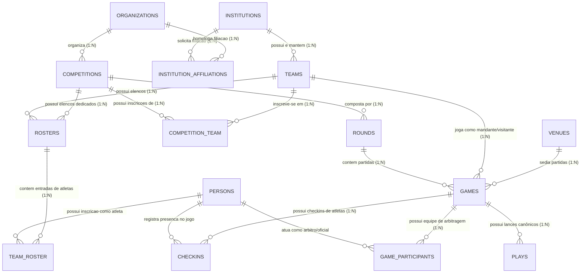
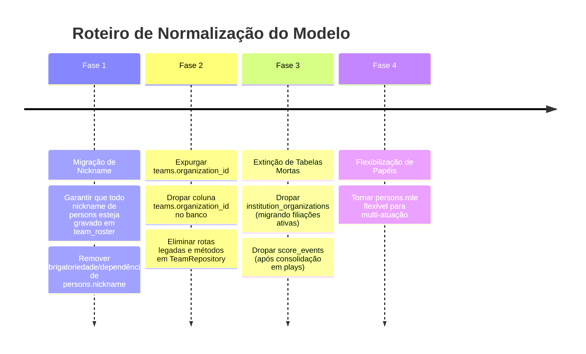

# Análise Profunda: Resolução de Conflitos, Incoerências e Fronteiras do Modelo de Dados

> **Projeto:** Flag Platform (Ecossistema America)  
> **Data:** 30 de Outubro de 2026  
> **Autoridade Arquitetural:** ADR-001, Domain-Driven Design (DDD) & Modulith  
> **Status:** Proposta de Alinhamento e Normalização Estrutural  

---

## 1. Visão Executiva e Diagnóstico Fundacional

O modelo de dados atual da Flag Platform reflete o crescimento orgânico da plataforma: iniciou com um schema simplificado (onde entidades de federação gerenciavam tudo diretamente) e evoluiu com a introdução do conceito formal de **Agremiação (`institutions`)**, **Súmula Eletrônica (`plays`)** e **Filiação Anual (`institution_affiliations`)**.

Entretanto, esse crescimento acumulou **conflitos conceituais graves**, campos alocados em tabelas incorretas e duplicações estruturais que violam as fronteiras dos *Bounded Contexts* do esporte:

```mermaid
flowchart TD
    subgraph Erros["Anomalias e Incoerências Atuais"]
        E1["`persons.nickname` — Apelido esportivo forçado na certidão de pessoa civil"]
        E2["`teams.organization_id` — Time vinculado à Federação em vez de pertencer à Agremiação"]
        E3["Duplicidade N:N: `institution_organizations` vs `institution_affiliations`"]
        E4["Duplicidade de Timeline: `score_events` vs `plays`"]
        E5["`persons.role` — Papel esportivo rígido engessando uma pessoa física com múltiplos papéis"]
    end

    subgraph Contextos["Fronteiras Canônicas do Domínio (DDD)"]
        C1["Identidade Civil: persons"]
        C2["Governança Federativa: organizations & institution_affiliations"]
        C3["Estrutura Clubística: institutions & teams"]
        C4["Competições: competitions, rounds & competition_team"]
        C5["Operação de Jogo: games, checkins, game_participants & plays"]
    end

    E1 -.->|Violou| C1
    E2 -.->|Violou| C3
    E3 -.->|Violou| C2
    E4 -.->|Violou| C5
    E5 -.->|Violou| C1
```

---

## 2. Inventário Detalhado dos Conflitos e Incoerências

### 2.1 Conflito 1: `nickname` em `persons` (Atributo Esportivo Forçado na Identidade Civil)

#### O Problema Conceitual:
A tabela `persons` representa o cadastro geral de **pessoas físicas** no ecossistema (portadoras de CPF único, nome civil completo, data de nascimento e foto de identificação).
- Nem toda pessoa física no ecossistema é um atleta em campo: existem **Árbitros (`REFEREE`)**, **Comissários (`COMMISSIONER`)**, **Delegados de Partida (`DELEGATE`)**, **Mesários (`SCORER`/`TIMEKEEPER`)**, **Presidentes de Clube** e **Treinadores (`COACH`)**.
- Nenhum árbitro, delegado ou presidente de federação possui ou deve possuir um "apelido de camisa" no seu registro civil de pessoa física.
- Além disso, no Flag Football, o apelido é contextualmente ligado ao time e à competição: o atleta é conhecido como `"Jota"` no time X com camisa `#10`. Se atuar em outra modalidade ou outro clube, sua identidade esportiva pertence ao elenco.

#### A Incoerência no Código:
- `persons` tem `nickname VARCHAR(100)`.
- `team_roster` tem `nickname VARCHAR(100)`.
- O código de `RosterService.toResponse()` precisava fazer fallback: `entity.getNickname() != null ? entity.getNickname() : person.nickname()`.
- O processo recente de inferência forçou que qualquer pessoa física sem apelido recebesse seu primeiro nome civil como "nickname", gerando apelidos artificiais até para árbitros e mesários.

#### Solução Canônica:
1. **Autoridade Absoluta:** O apelido esportivo pertence exclusivamente à entrada do elenco: **`team_roster.nickname`**.
2. **Limpeza em `persons`:** Remover `nickname` da tabela `persons` e do `PersonEntity`. O cadastro civil da pessoa mantém apenas `name` (nome civil completo).
3. **Apresentação Visual:** No Trunfo do Atleta e na Súmula, o nome de guerra/apelido é extraído de `team_roster.nickname`, e na sua ausência utiliza-se o primeiro nome civil extraído em tempo de exibição (`InferenceUtils.inferFirstName(person.name)`), sem persistir lixo na tabela civil.

---

### 2.2 Conflito 2: `teams.organization_id` (Quebra da Hierarquia de Propriedade do Clube)

#### O Problema Conceitual:
Na governança do esporte:
- **Federação (`Organization`):** Entidade de administração do desporto. Organiza torneios e filia agremiações. Uma federação **NÃO possui equipes esportivas**.
- **Agremiação / Clube (`Institution`):** Entidade de prática desportiva. É o clube (ex: *Corinthians*, *Taubaté Big Donkeys*, *Spartans*). O clube é o **proprietário de direito e fato das suas equipes**.
- **Equipe (`Team`):** É o esquadrão esportivo do clube (ex: *Spartans Black*, *Brokenstones Feminino*). Um time pertence **100% à sua Agremiação (`institution_id`)**.

#### A Incoerência no Código:
A tabela `teams` possui:
- `institution_id UUID NOT NULL` (adicionado e consolidado na Fase 3).
- `organization_id UUID NULL` (herança legada da época em que não existia a tabela `institutions`).
- Quase todos os times em Staging/Produção possuem `organization_id = NULL`.
- O `TeamRepository` possui métodos redundantes e bifurcados: `findAllByOrganizationId`, `existsByOrganizationIdAndNameIgnoreCase`, gerando duplicidade de queries.
- A API `/api/v1/organizations/{id}/teams` já foi marcada como `@Deprecated`.
- No frontend `flag_admin_web`, o modelo `Team` **sequer possui `organizationId`**, pois já entende que time pertence ao clube!

#### Solução Canônica:
1. **Remoção da Coluna:** Dropar a coluna `organization_id` da tabela `teams`.
2. **Remoção das Queries Residuais:** Excluir métodos baseados em `organizationId` no `TeamRepository`.
3. **Vínculo com Torneios:** Um time compete em um campeonato de uma Federação através da tabela de inscrição **`competition_team`** (`competition_id` $\rightarrow$ `competitions.organization_id`).

---

### 2.3 Conflito 3: Duplicidade entre `institution_organizations` e `institution_affiliations`

#### O Problema Conceitual:
Existem duas tabelas no banco de dados que expressam a relação entre um Clube e uma Federação:
1. **`institution_organizations`:** Tabela N:N crua (`institution_id`, `organization_id`, `created_at`, `created_by`). Não possui ano/temporada, não possui status, não guarda histórico e não permite aprovação/rejeição.
2. **`institution_affiliations`:** Entidade rica de domínio. Modela o processo formal de filiação federativa anual (`institution_id`, `organization_id`, `season`, `status`: `PENDING`/`APPROVED`/`REJECTED`, `requested_at`, `reviewed_at`, `rejection_reason`).

#### A Incoerência no Código:
- Em `TeamService.create(UUID organizationId, ...)` legada, o sistema consulta `institutionOrgRepo.findInstitutionIds(organizationId)` para adivinhar a qual clube o time pertence.
- A existência concomitante permite que um clube esteja na tabela estática `institution_organizations`, mas tenha sido `REJECTED` ou esteja inativo na filiação anual de `institution_affiliations`.

#### Solução Canônica:
1. **Descontinuação e Drop:** Dropar a tabela legada `institution_organizations`.
2. **Fonte Única da Verdade:** A relação entre Clube e Federação é exclusivamente gerida através de **`institution_affiliations`**.

---

### 2.4 Conflito 4: `persons.role` (Papel Rígido engessando a Pessoa Física)

#### O Problema Conceitual:
A tabela `persons` possui uma coluna `role NOT NULL` baseada no enum `PersonRole` (`ATHLETE`, `COACH`, `TECHNICAL_STAFF`, `REFEREE`, `DELEGATE`, `COMMISSIONER`).
- No mundo real do esporte amador e universitário brasileiro, **o papel de uma pessoa física é contextual**:
  - No sábado de manhã, uma pessoa pode apitar um jogo como Árbitro Principal (`GameParticipant`).
  - No domingo à tarde, a mesma pessoa pode jogar como Atleta (`RosterEntry`) por uma equipe em outra categoria.
  - Um técnico de um time feminino pode ser atleta no time masculino.
- Com `persons.role` obrigatório e `cpf` com constraint UNIQUE, a pessoa fica bloqueada: se for cadastrada como `REFEREE`, não pode entrar no elenco como `ATHLETE` sem alterar seu cadastro mestre.

#### Solução Canônica:
1. **Tornar `persons.role` opcional ou transferi-lo para um papel primário / padrão de cadastro (`default_role`), sem bloquear atuações contextuais.**
2. **Papel Efetivo é Contextual:**
   - Na partida / mesa: definido em `game_participants.role` e `game_participants.function`.
   - No time / elenco: definido em `team_roster` (onde pode ser especificado se a entrada é de Atleta ou Membro da Comissão Técnica).

---

### 2.5 Conflito 5: Duplicidade de Linha do Tempo (`score_events` vs `plays`)

#### O Problema Conceitual:
- **`score_events`:** Criado na V1 da plataforma para gravar apenas os eventos que alteravam pontuação (`game_id`, `team_id`, `points`, `play_type`, `quarter`).
- **`plays`:** Desenvolvido para a súmula eletrônica completa do Flag Football (`flag_referee_app`). Grava **todos os lances**: Touchdowns, Conversões de 1 e 2 pontos, Safeties, Passes Completos/Incompletos, Corridas, Interceptações, Sacks, Faltas, jardas ganhas, tempos de jogo e pontuação associada (`points_to_add`).

#### A Incoerência no Código:
- Ao salvar um lance em `plays`, o `PlayService` emite um evento interno no Spring, e o `GameService` grava uma duplicata resumida em `score_events`.
- A API legada `POST /games/{id}/score/events` já foi marcada como `@Deprecated`.

#### Solução Canônica:
1. **Eliminar a Duplicidade:** Descontinuar a tabela `score_events`.
2. A entidade canônica para linha do tempo, estatísticas e lances de uma partida é **`PlayEntity` (`plays`)**. A pontuação do jogo é a soma dos lances de pontuação de `plays`.

---

### 2.6 Conflito 6: Padronização de Nomenclatura no Domínio

| Tabela Atual | Conceito Real de Domínio | Proposta de Alinhamento / Semântica |
|---|---|---|
| **`team_roster`** | Linhas/entradas de atletas no elenco (`RosterEntry`) | Manter no banco como `team_roster` por compatibilidade de schema, mas garantir que todas as classes Java e APIs utilizem a semântica `RosterEntry`. |
| **`rosters`** | Cabeçalho do Elenco (`Roster` - Base ou Competição) | O cabeçalho possui `team_id` e opcionalmente `competition_id`. Se `competition_id` for nulo, representa o elenco-base permanente. |
| **`competition_team`** | Inscrição de Equipe em Torneio | Modela a participação do time no campeonato, balde, divisão e chaveamento (`seed_number`). |
| **`checkins`** | Relação de Atletas Escalados na Partida | Lista de atletas do time presentes e aptos para a partida na súmula. |
| **`game_participants`** | Quadro de Oficiais da Partida | Árbitros, mesários, cronometristas e delegados alocados na partida. |

---

## 3. Matriz Arquitetural de Entidades e Relacionamentos Canônicos



### Regras Mandatórias de Integridade e Isolamento:
1. **Pessoa (`persons`):** Nunca possui `nickname`. Apenas nome civil completo, CPF, data de nascimento, gênero e foto.
2. **Equipe (`teams`):** Nunca possui `organization_id`. Possui apenas `institution_id` (obrigatório), `name`, `short_name`, `sport_name`, `logo_url` e `status`.
3. **Elenco (`team_roster`):** É o detentor exclusivo de `nickname` (apelido de jogo), `number` (número da camisa) e `positions`.
4. **Filiação:** A única ponte entre Federação (`organizations`) e Clube (`institutions`) é `institution_affiliations`.
5. **Partida:** A única linha do tempo e fonte de lances é `plays`.

---

## 4. Plano de Execução Fatorado e Seguro (Sem Quebrar Produção)

Para executar a correção sem causar indisponibilidade em Staging/Produção ou incompatibilidade nos apps móveis:



### Etapa 1: Normalização de `nickname` (Próximo Passo)
- Criar migration Liquibase para garantir que todo apelido existente em `persons` seja copiado para `team_roster.nickname` caso esteja vazio no time.
- Remover a coluna `nickname` de `persons` no schema e no `PersonEntity`.
- Ajustar `PersonResponse`, `PersonRequest` e mappers para tratar `nickname` como atributo exclusivo de `RosterEntry`.

### Etapa 2: Remoção definitiva de `teams.organization_id`
- Criar migration Liquibase: `ALTER TABLE teams DROP COLUMN organization_id`.
- Limpar `TeamEntity.java` removendo o campo `organizationId`.
- Remover `organizationId` do `TeamResponse` e `CreateTeamRequest`.
- Excluir do `TeamRepository` as queries legadas `findAllByOrganizationId...`.

### Etapa 3: Desativação de `institution_organizations` e `score_events`
- Migrar qualquer vínculo remanescente para `institution_affiliations`.
- Dropar a tabela `institution_organizations`.
- Remover a entidade `InstitutionOrganizationEntity` e seu repositório.
- Redirecionar consultas de linha do tempo diretamente para a tabela `plays`.

---

## 5. Recomendações e Próximas Ações

1. **Aprovação do Diagnóstico:** Confirmar o plano de normalização apresentado.
2. **Execução da Etapa 1 e 2:** Iniciar imediatamente a remoção de `persons.nickname` e `teams.organization_id` no backend com migration Liquibase compatível com Oracle ADB e Postgres.
3. **Validação nos Apps:** Garantir que `flag_public_app`, `flag_referee_app` e `flag_admin_web` leiam o `nickname` a partir de `team_roster` / `RosterEntry`, mantendo `flutter analyze` com 0 erros.
