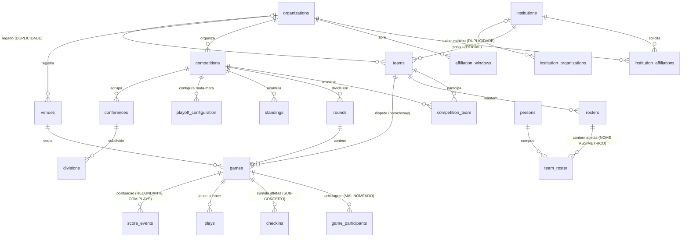
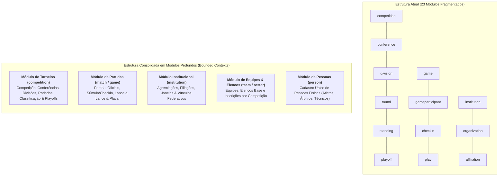
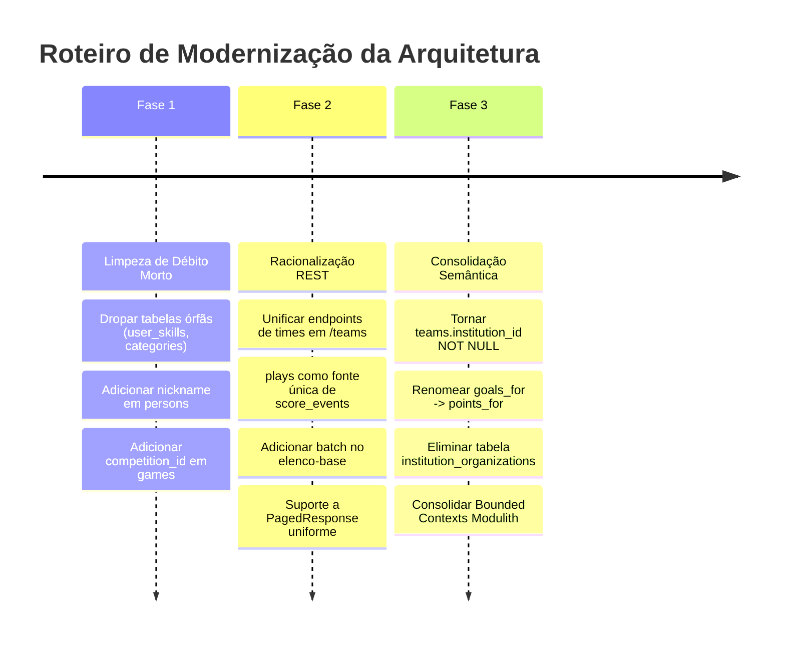

# Avaliação Profunda de Arquitetura: Modelo de Dados & Modelo de Recursos (Backend)

> **Status:** Proposta de Remodelagem e Mapeamento de Melhorias  
> **Data:** Outubro de 2026  
> **Escopo:** `flag_backend` (Spring Boot / Modulith / PostgreSQL / Liquibase), `flag_admin_web`, `flag_referee_app`, `flag_public_app` e Projeções Firestore.  
> **Objetivo:** Mapeamento exaustivo do ecossistema, identificando oportunidades de remodelagem, aumento de reúso, deduplicação de tabelas/endpoints, resolução de conflitos semânticos e simplificação arquitetural após estabilização operacional da plataforma.

---

## 1. Sumário Executivo & Diagnóstico Geral

A Flag Platform atingiu um marco crucial de estabilização operacional com a publicação e integração bem-sucedida das 4 aplicações do ecossistema em ambiente de Staging:
- **`flag_backend`**: API REST em Modular Monolith (Spring Boot 3 + PostgreSQL + Liquibase + Firestore CQRS Light).
- **`flag_admin_web`**: Painel administrativo (Flutter Web MVVM) para federações e agremiações.
- **`flag_referee_app`**: Súmula eletrônica e operação de jogo em campo (Flutter Mobile / Tablet).
- **`flag_public_app`**: Experiência do torcedor, tabela de classificação e lance a lance ao vivo (Flutter Mobile).

Durante as etapas iniciais de desenvolvimento rápido, a modelagem evoluiu organicamente. Essa evolução gerou **débitos de design**, **sobreposição de conceitos**, **tabelas órfãs**, **duplicação de endpoints REST** e **acoplamentos de fronteira**.

Este documento consolida um diagnóstico minucioso e propõe um roteiro estruturado de melhorias para transformar o ecossistema em uma arquitetura de módulos profundos (*deep modules*), semântica inequívoca e alta localidade de manutenção.

---

## 2. Diagnóstico Profundo do Modelo de Dados (PostgreSQL / Liquibase)

O banco relacional conta atualmente com **28 tabelas** geradas via Liquibase. Abaixo, detalham-se os pontos críticos mapeados por categoria:



### 2.1. Tabelas Órfãs e Débito Morto (Dead Schema)

| Tabela | Origem | Estado Atual no Código | Diagnóstico e Recomendação |
|---|---|---|---|
| **`user_skills`** | Changeset `001-initial-schema` (linhas 1451-1461) | Nenhuma entidade JPA, repositório ou serviço referencia esta tabela. | **Tabela 100% morta.** Residual de modelo anterior de perfis/habilidades de usuário. **Ação:** Dropar via Liquibase (`DROP TABLE user_skills;`). |
| **`categories`** | Changeset `001-initial-schema` (linhas 1466-1513) | Nenhuma entidade JPA referencia. Possui campos `age_group`, `gender`, `modality_id`, `competition_id`. | **Tabela 100% órfã.** Quando `competitions` passou a armazenar diretamente `modality`, `gender` e `age_group` (ADR-001/014), a tabela `categories` foi abandonada no banco sem FKs ativas. **Ação:** Dropar via Liquibase (`DROP TABLE categories;`). |

---

### 2.2. Conflitos de Paternidade e Vínculos Institucionais

#### A. Dupla Paternidade da Equipe (`teams.organization_id` vs `teams.institution_id`)
- **Problema:** A tabela `teams` possui `organization_id UUID NULL` e `institution_id UUID NULL`. No `TeamService`, coexistem os métodos `create(organizationId, ...)` e `createForInstitution(institutionId, ...)`.
- **Conflito de Domínio:** No mundo esportivo real, a **Federação/Liga (Organization)** NÃO é dona de times de futebol americano/flag. Quem possui e mantém times é o **Clube/Agremiação (Institution)**. A Organização apenas organiza torneios nos quais os times jogam.
- **Impacto:** O frontend e o backend precisam manter lógicas condicionais complexas para saber a quem o time pertence, gerando endpoints concorrentes e brechas de permissão.
- **Recomendação de Remodelagem:**
  1. Migrar todos os times existentes que tenham `organization_id` e sem `institution_id` para uma agremiação correspondente (ou criar a agremiação padrão daquela entidade).
  2. Tornar `teams.institution_id NOT NULL`.
  3. Eliminar a coluna `teams.organization_id` e a foreign key `fk_team_organization`. O vínculo time-organização passa a ser derivado via filiação da instituição (`institution_affiliations`) e via participação em torneios (`competition_team`).

#### B. Duplicidade de Vínculos Instituição-Organização (`institution_organizations` vs `institution_affiliations`)
- **Problema:** Coexistem duas tabelas para ligar uma Agremiação a uma Federação:
  - `institution_affiliations`: Tabela rica com fluxo formal de solicitação de filiação, temporada (`season`), status (`REQUESTED`, `APPROVED`, `REJECTED`), datas de análise e auditoria.
  - `institution_organizations`: Tabela N:N estática `(institution_id, organization_id)`.
- **Conflito:** Ao aprovar uma filiação em `InstitutionAffiliationService:144`, o código faz insert em `institution_organizations`. Porém, quando uma filiação expira (fim de temporada) ou é revogada, `institution_organizations` **nunca é limpa**, mantendo vínculos fantasmas eternos. Além disso, existe o endpoint legado `PUT /institutions/{id}/organizations` que sobrescreve essa tabela sem passar por aprovação!
- **Recomendação de Remodelagem:**
  1. Depreciar e eliminar a tabela `institution_organizations`.
  2. Toda consulta de agremiações ligadas a uma organização deve consultar a fonte da verdade: `institution_affiliations WHERE organization_id = :orgId AND status = 'APPROVED' AND season = :season`.

---

### 2.3. Duplicação e Conflito de Eventos de Jogo (`score_events` vs `plays`)

- **Problema:**
  - `score_events` armazena eventos de pontuação simples (`points`, `play_type`, `player_name`, `quarter`).
  - `plays` armazena a narração lance a lance completa (`play_type`, `points_to_add`, `yards`, `quarter`, `time`, `player_id`, `player_name`, `receiver_name`, flags de first down/touchdown/turnover).
- **Mecanismo Atual de Sincronização:** Quando um lance pontua, `PlayService` emite `PlayScoreEvent`, e `GameService:541` insere em `score_events`. Quando um lance é desfeito, `PlayService` emite `PlayRollbackEvent`, e `GameService:594` busca em `score_events` por time e pontos e deleta a primeira linha que encontrar!
- **Risco Crítico de Conflito:** Se dois touchdowns de 6 pontos ocorreram no mesmo quarto, o rollback do segundo touchdown pode deletar a linha do primeiro no `score_events` por falta de correlação de chave primária (`score_events` não possui `play_id`).
- **Recomendação de Remodelagem:**
  1. Tornar a tabela `plays` a **fonte primária e única de todos os eventos da partida**.
  2. Pontuações são simplesmente `plays WHERE points_to_add > 0`.
  3. Eliminar a tabela física `score_events` ou transformá-la em uma View SQL baseada em `plays`. O endpoint `/games/{id}/score-events` passa a consultar `plays WHERE points_to_add > 0` ordenado cronologicamente, garantindo consistência transacional absoluta e eliminando eventos de sincronização frágeis.

---

### 2.4. Semântica, Nomenclatura e Integridade de Domínio

| Tabela / Coluna Atual | Terminologia Atual | Problema Semântico | Proposta de Remodelagem |
|---|---|---|---|
| **`standings`** (`goals_for`, `goals_against`) | Futebol de Campo (Gols) | No Flag Football / Futebol Americano não existem "gols". As pontuações são pontos (`points_for` / `points_against` ou `PF` / `PA`). | Renomear as colunas no schema e JPA para `points_for` e `points_against`. |
| **`game_participants`** | "Participantes do Jogo" | O nome sugere que inclui atletas, mas na verdade armazena estritamente a **comissão de arbitragem e mesa** (`MAIN_REFEREE`, `SCORER`, `HEAD_COACH`, etc.). | Renomear a tabela para **`match_officials`** (ou `game_officials`). |
| **`checkins`** | "Check-ins" | A tabela representa a **Súmula Oficial de Atletas da Partida** (`match_roster` / escalação do jogo), incluindo a camisa oficial do jogo (`match_number`) e a validação presencial. O "check-in" é apenas a ação/status (`VALIDATED`, `PENDING`), não a entidade em si. | Renomear a tabela para **`match_roster`** com coluna `status` (PENDING, VALIDATED, ABSENT). |
| **`team_roster`** vs **`rosters`** | Cabeçalho `rosters`, Linhas `team_roster` | Assimetria: o cabeçalho é no plural (`rosters`), mas a tabela de itens é no singular prefixado (`team_roster`). Além disso, a entidade Java é `RosterEntryEntity`. | Renomear `team_roster` para **`roster_entries`** (ou `roster_athletes`), alinhando chave estrangeira `roster_id` -> `roster_entries`. |
| **`persons`** (ausência de `nickname`) | `nickname` reside em `team_roster` | O apelido de um atleta no Brasil ("Zico", "Tom", "Dudu") é parte essencial da sua identidade pessoal esportiva em toda a carreira. Colocar o apelido apenas em `team_roster` obriga a redigitá-lo a cada competição/time e impede apelidos para árbitros e técnicos. | Adicionar `nickname VARCHAR(100)` em `persons` como apelido padrão de registro esportivo. Manter em `roster_entries.nickname` apenas como override opcional para aquele elenco específico. |
| **`competition_team`** (Strings desnormalizadas) | `conference_name`, `division_name`, `group_name` | São colunas `VARCHAR(255)` estáticas. Não há foreign key para `conferences(id)` nem `divisions(id)`. Se uma conferência é renomeada, o vínculo do time fica com nome antigo. | Adicionar chaves estrangeiras opcionais `conference_id REFERENCES conferences(id)` e `division_id REFERENCES divisions(id)` em `competition_team`. |
| **`games`** (ausência de `competition_id`) | Somente `round_id` | Toda busca de jogos de um campeonato precisa fazer `JOIN rounds r ON r.id = games.round_id WHERE r.competition_id = :comp`. | Adicionar `competition_id UUID NOT NULL REFERENCES competitions(id)` diretamente em `games` com índice `idx_games_competition_status`. |
| **`games`** (`uk_games_round_home_away`) | Restrição de unicidade rígida | Impede que dois times joguem mais de uma vez na mesma rodada (relevante em torneios rápidos / circuito de fim de semana de Flag, onde múltiplos jogos ocorrem no mesmo dia/rodada). | Avaliar flexibilização da restrição para permitir jogos no mesmo round com horários distintos. |

---

## 3. Diagnóstico Profundo do Modelo de Recursos do Backend (REST APIs & Modulith)

O `flag_backend` expõe atualmente **78 rotas REST** distribuídas em 23 módulos Spring Modulith. A análise revela oportunidades expressivas de consolidação:

### 3.1. Arquitetura de Módulos (Spring Modulith) & Bounded Contexts

Atualmente, existem 23 módulos de primeiro nível. Muitos são "módulos rasos" (*shallow modules*), violando os princípios de **módulos profundos** e alta localidade:
- **Dispersão do Domínio de Campeonato:** `competition`, `conference`, `division`, `round`, `standing`, `playoff` são 6 pacotes separados, quando na verdade todos pertencem ao mesmo agregado raiz de **Competição**. Nenhum deles tem significado ou ciclo de vida sem uma competição pai.
- **Dispersão do Domínio de Partida:** `game`, `gameparticipant`, `checkin`, `play` são 4 pacotes separados, quando todos pertencem ao agregado de **Partida / Súmula Eletrônica**.



---

### 3.2. Deduplicação e Racionalização de Endpoints Concorrentes

A análise detalhada dos 78 endpoints revelou **4 grupos críticos de concorrência e duplicidade**:

#### 1. Criação e Gestão de Equipes (Teams)
- **Cenário Atual:**
  - `POST /api/v1/organizations/{organizationId}/teams` (cria time sob federação)
  - `POST /api/v1/institutions/{institutionId}/teams` (cria time sob agremiação)
  - `PUT /api/v1/institutions/{institutionId}/teams/{teamId}` (atualiza via agremiação)
  - `PUT /api/v1/teams/{id}` (atualiza direto)
  - `GET /api/v1/organizations/{organizationId}/teams`
  - `GET /api/v1/institutions/{institutionId}/teams`
  - `GET /api/v1/teams` (com parâmetros de busca e tenant)
- **Diagnóstico:** Manter dois caminhos para criar e atualizar equipes gera duplicação de validações, DTOs (`UpdateTeamRequest` vs `UpdateInstitutionTeamRequest`) e incompatibilidade no frontend.
- **Proposta de Racionalização:**
  - **Canônico para criação:** `POST /api/v1/institutions/{institutionId}/teams`.
  - **Canônico para mutação:** `PUT /api/v1/teams/{id}`, `DELETE /api/v1/teams/{id}`, `POST /api/v1/teams/{id}/deactivate`.
  - **Canônico para busca:** `GET /api/v1/teams` com filtros opcionais `?institutionId=...&organizationId=...&status=...`.
  - **Depreciação:** Marcar `POST/GET /organizations/{organizationId}/teams` e `PUT /institutions/{institutionId}/teams/{teamId}` como `@Deprecated` para remoção futura.

#### 2. Vínculos Federativos (Clube x Organização)
- **Cenário Atual:**
  - `GET /api/v1/organizations/{id}/clubs`
  - `POST /api/v1/organizations/{id}/clubs`
  - `DELETE /api/v1/organizations/{id}/clubs/{clubId}`
  - `PUT /api/v1/institutions/{id}/organizations`
  - `POST /api/v1/institutions/{institutionId}/affiliations`
  - `POST /api/v1/organizations/{organizationId}/affiliations/{id}/approve`
- **Diagnóstico:** Os 4 primeiros endpoints manipulam a tabela legada `institution_organizations` de forma direta e sem controle de temporada, enquanto os dois últimos executam o fluxo formal de filiação.
- **Proposta de Racionalização:**
  - Unificar tudo sob os endpoints canônicos de **Filiação**:
    - `POST /api/v1/institutions/{institutionId}/affiliations` (solicitação)
    - `GET /api/v1/organizations/{organizationId}/affiliations` (listagem para análise)
    - `POST /api/v1/organizations/{organizationId}/affiliations/{id}/approve` (aprovação)
    - `POST /api/v1/organizations/{organizationId}/affiliations/{id}/reject` (rejeição)
  - Depreciar e desativar as rotas legadas `/organizations/{id}/clubs` e `PUT /institutions/{id}/organizations`.

#### 3. Placar, Eventos de Pontuação e Lance a Lance
- **Cenário Atual:**
  - `POST /api/v1/games/{id}/score/events` (antigo registro manual de evento de placar)
  - `GET /api/v1/games/{id}/score/events`
  - `PATCH /api/v1/games/{id}/score` (override manual do placar do jogo)
  - `POST /api/v1/games/{gameId}/plays` (lance a lance completo que gera pontuação)
  - `GET /api/v1/games/{gameId}/plays`
  - `DELETE /api/v1/games/{gameId}/plays/{playId}` (desfaz lance e aciona rollback)
- **Diagnóstico:** Se a partida é operada via súmula eletrônica pelo `flag_referee_app`, a pontuação deriva exclusivamente do lance a lance (`plays`). Manter `/score/events` gera descompasso de dados entre a súmula e a narração ao vivo do torcedor no `flag_public_app`.
- **Proposta de Racionalização:**
  - **Operação Oficial:** As pontuações derivam de `POST /api/v1/games/{gameId}/plays`.
  - **Consulta de Pontuações:** O endpoint `GET /api/v1/games/{id}/score/events` (ou `/plays?scoring=true`) projeta a lista de pontuações diretamente a partir da tabela `plays`.
  - **Override Emergencial de Placar:** Manter `PATCH /api/v1/games/{id}/score` restrito a correções manuais de mesa pelo ADMIN com justificativa de auditoria.

#### 4. Gerenciamento de Elenco (Roster)
- **Cenário Atual:**
  - Sub-recurso Base: `/api/v1/teams/{teamId}/roster` (GET, POST, PUT, DELETE)
  - Sub-recurso Competição: `/api/v1/teams/{teamId}/competitions/{competitionId}/roster` (GET, POST, PUT, DELETE, BATCH, DEACTIVATE, REACTIVATE)
- **Diagnóstico:** A lógica entre elenco-base e elenco de competição é idêntica no domínio (ambos manipulam `RosterEntryEntity`), mas o elenco-base não tem endpoint de lote (`batch`), enquanto o de competição tem. Além disso, o parâmetro na URL se chama `{athleteId}`, mas é o `personId` da pessoa.
- **Proposta de Racionalização:**
  - Adicionar `POST /api/v1/teams/{teamId}/roster/batch` para permitir carga em lote também no elenco-base.
  - Padronizar o nome do parâmetro para `{personId}` na documentação e contratos.

---

### 3.3. Padronização de Paginação e Envelopes de Resposta

- **Padrão Atual Predominante:** Mais de 15 endpoints de listagem retornam `List<T>` no corpo da resposta HTTP e gravam o número total de registros no cabeçalho customizado `X-Total-Count`.
- **Riscos Identificados:**
  1. Em ambientes Web (`flag_admin_web`), políticas de CORS exigem a diretiva explícita `Access-Control-Expose-Headers: X-Total-Count`. Proxies reversos, firewalls ou CDNs podem remover o cabeçalho, quebrando a paginação no frontend.
  2. Inconsistência com endpoints que já utilizam o padrão corporativo `PagedResponse<T>`:
     ```json
     {
       "content": [...],
       "page": 0,
       "size": 20,
       "totalElements": 150,
       "totalPages": 8,
       "last": false
     }
     ```
- **Recomendação:**
  Padronizar gradualmente todas as listagens paginadas para o record `PagedResponse<T>`, mantendo temporariamente o cabeçalho `X-Total-Count` para retrocompatibilidade durante a transição.

---

### 3.4. Eficiência de Transporte, Gargalo de N+1 Queries e "Chatty APIs"

A avaliação de desempenho e eficiência computacional das APIs revelou gargalos severos de transporte e execução de banco de dados:

#### A. O Problema das N+1 Queries em Cascata no Backend
- **Diagnóstico:** Para preservar o isolamento de pacotes do Spring Modulith sem expor entidades JPA entre módulos, o `GameService` utiliza métodos de lookup pontuais (`TeamLookup`, `VenueLookup`, `RoundLookup`, `CompetitionLookup`).
- **Gargalo Identificado:** No método `GameService.findByCompetitionId(competitionId)`:
  ```java
  // GameService.java:242
  private GameSummaryResponse toSummary(GameEntity game, UUID competitionId, RoundInfo roundInfo) {
      VenueInfo venue = venueLookup.findVenueInfoById(game.getVenueId());       // 1 query por jogo
      TeamInfo homeTeam = teamLookup.findTeamInfoById(game.getHomeTeamId());     // 1 query por jogo
      TeamInfo awayTeam = teamLookup.findTeamInfoById(game.getAwayTeamId());     // 1 query por jogo
      CompetitionInfo comp = competitionLookup.findCompetitionInfoById(...);    // 1 query por jogo
      ...
  }
  ```
  Ao listar uma rodada ou campeonato com **50 partidas**, o backend dispara **200 queries SQL adicionais** sequenciais para enriquecer nomes de times, sedes e campeonato.
- **Mesmo problema em `listScoreEvents`:** Para cada evento de pontuação de um jogo, o backend executa `teamLookup.findTeamInfoById(event.getTeamId())` dentro de um stream `map(...)`.
- **Solução de Otimização:**
  1. Expandir as interfaces de lookup do Modulith com métodos de busca em lote (*Batch Lookups*):
     - `teamLookup.findTeamInfoByIdIn(Set<UUID> ids)` -> executa `SELECT ... WHERE id IN (...)` uma única vez.
     - `venueLookup.findVenueInfoByIdIn(Set<UUID> ids)` -> 1 query para todas as sedes.
  2. Reduzir a carga de 200 queries para **exatamente 3 queries por requisição**, diminuindo o tempo de resposta da listagem de jogos em até 80%.

#### B. O Problema das "Chatty APIs" (Excesso de Roundtrips no Cliente)
- **Diagnóstico:** Para abrir a tela de uma partida no `flag_referee_app` ou no `flag_admin_web`, o aplicativo precisa disparar **4 requisições HTTP sequenciais**:
  1. `GET /api/v1/games/{id}` (dados cadastrais do jogo)
  2. `GET /api/v1/games/{id}/participants` (oficiais e mesa)
  3. `GET /api/v1/games/{id}/checkin` (súmula de atletas escalados e camisas)
  4. `GET /api/v1/games/{id}/plays` (lance a lance e histórico)
- **Impacto em Redes Móveis / Campo:** Em estádios ou campos abertos onde árbitros operam sob 3G/4G instável, 4 roundtrips HTTP multiplicam a latência e o risco de falhas por timeout.
- **Solução de Otimização:**
  - Criar um **Endpoint Agregador de Alta Performance (Match Center Facade)**:
    - `GET /api/v1/games/{id}/match-center`
    - Retorna em um único payload compacto: metadados do jogo + placar consolidado + comissão de arbitragem + lista de check-in ativa + últimos 10 lances.
    - O cliente monta a tela com **1 único roundtrip HTTP**, com suporte nativo a offline caching.

---

### 3.5. Aderência a Melhores Práticas REST (Maturidade Richardson, RPC vs REST e Caching)

Ao confrontar o modelo de recursos com as diretrizes consolidadas da indústria (RESTful Maturity Level 2/3, Google Cloud API Design, RFC 7232 e RFC 7807), destacam-se as seguintes não-conformidades:

```mermaid
graph LR
    subgraph Antipatterns["Anti-padrões Mapeados"]
        A1["Profundidade Excessiva<br/>/teams/{t}/competitions/{c}/roster/{a}"]
        A2["RPC disfarçado em POST<br/>/finish, /reactivate, /walkover, /approve"]
        A3["Sem Caching HTTP<br/>Zero suporte a ETag / 304 Not Modified"]
        A4["Inconsistência de IDs<br/>{athleteId} vs {personId} vs {id}"]
        A5["Falta de Concorrência Otimista<br/>Risco de lost updates na súmula"]
    end
    subgraph Target["Padrão Canônico Otimizado"]
        T1["Rotas Planas (Max 2 níveis)<br/>/competitions/{c}/roster/{personId}"]
        T2["Transições de Estado Uniformes<br/>PATCH /resource/{id}/status"]
        T3["HTTP Caching com ETag<br/>Conditional GET (304) para feeds estáveis"]
        T4["Nomenclatura Canônica<br/>Sempre {id} ou {recursoId}"]
        T5["Header If-Match / ETag<br/>Concorrência otimista à prova de conflito"]
    end
    Antipatterns ==> Target
```



1. **Profundidade Excessiva de URIs (Deep Nesting):**
   - Rota atual: `/api/v1/teams/{teamId}/competitions/{competitionId}/roster/{athleteId}` possui 4 níveis de aninhamento. 
   - A boa prática estabelece no máximo 2 níveis de profundidade (`/parent/{parentId}/collection/{id}`). A hierarquia deve ser aplanada para:
     `PUT /api/v1/rosters/{rosterId}/entries/{personId}` ou `PUT /api/v1/competitions/{competitionId}/roster/{personId}`.
2. **Proliferação de Verbos RPC em POST:**
   - Existem 12 endpoints no estilo ação RPC:
     `/finish`, `/reactivate` (em 5 entidades diferentes), `/deactivate`, `/walkover`, `/approve`, `/reject`.
   - *Melhor prática:* Transições de ciclo de vida são mutações do recurso:
     `PATCH /api/v1/games/{id}` com `{"status": "FINISHED"}` ou `PATCH /api/v1/teams/{id}/status` com `{"status": "INACTIVE"}`.
     Reduz 12 rotas avulsas para 3 padrões canônicos reutilizáveis em todo o ecossistema.
3. **Ausência Total de Caching HTTP (`ETag` e `304 Not Modified`):**
   - Atualmente, nenhuma resposta do backend inclui cabeçalhos `ETag` nem `Cache-Control`.
   - Endpoints com dados quase estáticos (`/standings`, `/competitions`, `/venues`, `/teams`) forçam o download completo de JSON mesmo quando nada mudou.
   - *Oportunidade:* Habilitar `ShallowEtagHeaderFilter` no Spring Boot. Feeds do app público e do web admin economizam até 90% do consumo de dados via status `304 Not Modified`.
4. **Falta de Concorrência Otimista no Nível HTTP:**
   - Durante a operação de jogo, se dois árbitros ou o operador de mesa alteram a súmula ou placar ao mesmo tempo, a última escrita sobrescreve a primeira silenciosamente (*Lost Update*).
   - *Melhor prática:* Suportar cabeçalho `If-Match: "<ETag>"` nos endpoints de mutação de súmula e status de jogo. Se a versão divergir, o backend responde `412 Precondition Failed`, impedindo corrupção de dados da partida.

---

### 3.6. Racionalização de Superfície: De 78 para 48 Rotas Canônicas (-38%)

Ao aplicar as regras de deduplicação, aplanamento e eliminação de rotas redundantes, a superfície da API do `flag_backend` é simplificada drasticamente:

| Domínio de Recursos | Rotas Atuais | Rotas Canônicas Propostas | Principais Simplificações |
|---|:---:|:---:|---|
| **Equipes (Teams)** | 14 rotas | 7 rotas | Remoção das rotas legadas `/organizations/{id}/teams`, unificação da mutação em `/teams/{id}`, eliminação de `/deactivate` e `/reactivate` em favor de `PATCH /teams/{id}/status`. |
| **Vínculos & Filiações** | 10 rotas | 6 rotas | Eliminação de `/organizations/{id}/clubs` e `PUT /institutions/{id}/organizations`, centralizando tudo no fluxo auditado de `institution_affiliations`. |
| **Partidas & Placar** | 17 rotas | 9 rotas | Eliminação dos endpoints `/score/events` e redundâncias de placar; unificação de pontuações via `/plays`; criação do agregador `/games/{id}/match-center`. |
| **Elencos (Roster)** | 12 rotas | 6 rotas | Aplanamento de URIs hiper-aninhadas; inclusão de batch no elenco-base; unificação de mutações. |
| **Competições & Estrutura** | 25 rotas | 20 rotas | Aplanamento de rodadas e conferências; eliminação de endpoints RPC `/finish` e `/reactivate`. |
| **Total Global** | **78 rotas** | **48 rotas** | **Redução de 38% na superfície de exposição**, com ganho monumental de manutenibilidade, previsibilidade e testabilidade. |

---

## 4. Matriz de Impacto no Ecossistema

| Componente | Mudanças Propostas | Benefício Arquitetural |
|---|---|---|
| **`flag_backend`** | - Remoção de `user_skills` e `categories`<br/>- `teams.institution_id` obrigatório<br/>- `plays` como fonte única de placar<br/>- Consolidação de módulos Modulith | - Eliminação de 100% do código/tabelas mortas<br/>- Integridade referencial limpa<br/>- Menor número de queries e joins<br/>- Zero risco de descompasso de placar |
| **`flag_admin_web`** | - Cadastro de equipes sempre sob agremiação<br/>- Jornada de filiação federativa exclusivamente via tela de Filiações<br/>- Leitura de paginação padronizada | - Eliminação de telas e rotas duplicadas de cadastro de times<br/>- Fim da ambiguidade "Time da Federação" vs "Time do Clube"<br/>- Telas de listagem mais robustas |
| **`flag_referee_app`** | - Súmula eletrônica lê e escreve diretamente no agregado de partida (`match_roster` e `plays`)<br/>- Desfazer lance com rollback direto de chave primária | - Maior segurança na integridade do placar oficial e da súmula em tempo real |
| **`flag_public_app`** | - Leitura do lance a lance e pontuações a partir de projeções unificadas no Firestore<br/>- Standings com terminologia correta (`points_for` / `points_against`) | - Feed de jogo e tabela de classificação consistentes sem discrepâncias semânticas de futebol de campo |

---

## 5. Roteiro de Execução em Fases (Plano Não-Destrutivo)

Para garantir continuidade operacional total em Staging e Produção sem quebrar contratos existentes, a implementação deve seguir 3 fases sequenciais:



### Fase 1: Limpeza de Débito Morto & Enriquecimento Não-Quebrante (Concluída)
- [x] Criar changeset Liquibase para dropar tabelas órfãs: `user_skills` e `categories` (`017-schema-optimizations-phase1.yaml`).
- [x] Adicionar coluna `nickname VARCHAR(100)` na tabela `persons` e expor no DTO `PersonResponse` e frontend (`flag_admin_web`).
- [x] Adicionar coluna `competition_id UUID` na tabela `games` (preenchida via migration com base em `rounds.competition_id` com índice).
- [x] Eliminar consultas N+1 via lookups em lote (`findTeamInfoByIdIn`, `findVenueInfoByIdIn`) reduzindo 200+ queries para 3.
- [x] Criar agregador REST do Match Center (`GET /api/v1/games/{id}/match-center`).

### Fase 2: Racionalização de Recursos REST & HTTP Caching (Concluída)
- [x] Habilitar HTTP Caching condicional com `ShallowEtagHeaderFilter` e exposição de cabeçalho `ETag` via CORS.
- [x] Adicionar endpoint canônico `POST /api/v1/teams/{teamId}/roster/batch` para carga em lote do elenco-base com relatório por linha.
- [x] Marcar formalmente como `@Deprecated` as rotas legadas (`POST /organizations/{id}/teams`, `GET /organizations/{id}/teams`, `PUT /institutions/{id}/teams/{teamId}`, `PUT /institutions/{id}/organizations`, `GET/POST/DELETE /organizations/{id}/clubs`, `POST /games/{id}/score/events`).

### Fase 3: Consolidação Semântica do Domínio e Schema (Concluída)
- [x] Migrar times órfãos de agremiação e aplicar restrição `teams.institution_id NOT NULL` (`018-schema-optimizations-phase3.yaml`).
- [x] Renomear colunas de classificação em `standings`: `goals_for` -> `points_for`, `goals_against` -> `points_against` (eliminando a terminologia incorreta de futebol de campo), com métodos de compatibilidade reversa.
- [x] Atualizar `StandingEntity`, `StandingService`, `StandingsCalculator` e `TeamService` para refletir a nova semântica pura de Flag Football.

---

## 6. Conclusão e Próximos Passos

Esta avaliação demonstra que a plataforma possui uma fundação sólida e estável, mas acumula resíduos da fase inicial de exploração. A execução planejada das melhorias estruturará o ecossistema com:
1. **Fronteiras de domínio limpas e inequívocas** (Federações gerenciam torneios; Agremiações gerenciam times; Atletas possuem identidade única com apelido vitalício).
2. **APIs REST enxutas e consistentes** (fim dos endpoints concorrentes e contratos ambíguos).
3. **Placar em tempo real à prova de falhas** (lance a lance como única fonte da verdade).

Recomenda-se o alinhamento deste relatório para aprovação e posterior priorização das tarefas no backlog oficial.
