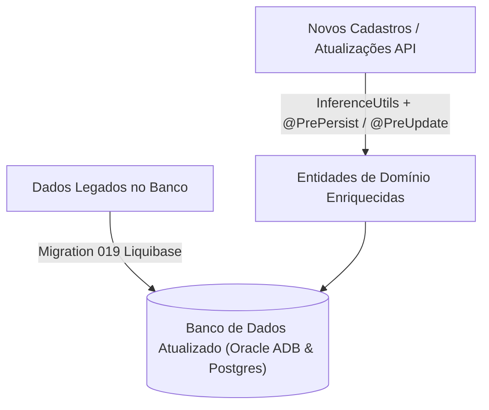

# Enriquecimento de Dados por Inferência no Ecossistema Flag Platform

## 1. Contexto e Motivação

Durante a evolução do ecossistema Flag Platform, diversas entidades passaram a acumular colunas e atributos opcionais que frequentemente permaneciam vazios (`NULL` ou string vazia) em cadastros legados ou simplificados.

Para garantir consistência visual, navegabilidade aprimorada em súmulas e aplicativos móveis, e aderência estrita às regras do esporte (Flag Football), foi realizada uma **revisão de 100% das tabelas do modelo**, aplicando regras determinísticas de **inferência de dados**.

---

## 2. Decisões Estratégicas de Inferência

1. **Apelido do Atleta (`nickname`)**:
   - **Regra Base**: O apelido padrão é o **primeiro nome** da pessoa (ex.: `"Lucas de Oliveira Silva"` $\rightarrow$ `"Lucas"`).
   - **Desambiguação por Homônimos**: Caso haja outro atleta no mesmo elenco com o mesmo primeiro nome, acrescenta-se a inicial do sobrenome (ex.: `"Lucas S."`).
   - **Sincronização Cruzada**: Se `team_roster.nickname` já estiver preenchido, herda-se para `persons.nickname`; se `persons.nickname` estiver preenchido, herda-se para `team_roster.nickname`.
2. **Gênero do Atleta (`gender`)**:
   - **Critério Estrito**: O gênero só é inferido se a pessoa estiver inscrita ou atuando em uma competição com gênero estrito (`competitions.gender IN ('MALE', 'FEMALE')`). Não há inferência heurística por terminação de nome próprio.
3. **Número da Camisa (`jersey_number` / `match_number`)**:
   - Se o número estiver ausente no elenco, herda o número de partidas já jogadas em `checkins.match_number`.
   - Se a partida não tiver número informado, herda o número oficial do elenco (`team_roster.jersey_number`).

---

## 3. Matriz Completa de Enriquecimento por Tabela

| Tabela | Coluna | Regra de Inferência | Fallback / Padrão |
|---|---|---|---|
| **`persons`** | `nickname` | 1º Herdar de `team_roster.nickname` 2º Extrair primeiro nome de `name` com desambiguação de sobrenome | Primeiro nome |
| **`persons`** | `gender` | Herdar de `competitions.gender` (onde gênero for `MALE` ou `FEMALE`) | Manter `NULL` se misto |
| **`team_roster`** | `nickname` | 1º Herdar de `persons.nickname` 2º Primeiro nome com inicial do sobrenome para homônimos no elenco | Primeiro nome |
| **`team_roster`** | `jersey_number` | Herdar de `checkins.match_number` daquela pessoa no mesmo time | Manter `NULL` se nunca jogou |
| **`team_roster`** | `status` | `ACTIVE` | `ACTIVE` |
| **`teams`** | `sport_name` | `'Flag Football'` | `'Flag Football'` |
| **`teams`** | `short_name` | Primeira palavra do nome do time em maiúsculas (máx. 15 chars) | Nome do time |
| **`teams`** | `logo_url` | Herdar de `institutions.logo_url` da agremiação mãe | Manter `NULL` |
| **`teams`** | `status` | `ACTIVE` | `ACTIVE` |
| **`institutions`** | `legal_name` | Herdar de `trade_name` (ou `name`) | `trade_name` |
| **`institutions`** | `abbreviation` | Iniciais das palavras principais ou primeiras 3 letras em maiúsculas | 3 letras maiúsculas |
| **`institutions`** | `country` | `'BR'` | `'BR'` |
| **`institutions`** | `document_type` | `14` dígitos $\rightarrow$ `'CNPJ'`; `11` dígitos $\rightarrow$ `'CPF'` | `NULL` |
| **`institutions`** | `status` | `'ACTIVE'` | `'ACTIVE'` |
| **`organizations`**| `legal_name` | Herdar de `trade_name` | `trade_name` |
| **`organizations`**| `abbreviation` | Iniciais maiúsculas de `trade_name` | 3 letras maiúsculas |
| **`organizations`**| `country` | `'BR'` | `'BR'` |
| **`organizations`**| `timezone` | `'America/Sao_Paulo'` | `'America/Sao_Paulo'` |
| **`organizations`**| `locale` | `'pt_BR'` | `'pt_BR'` |
| **`organizations`**| `document_type` | `14` dígitos $\rightarrow$ `'CNPJ'`; `11` dígitos $\rightarrow$ `'CPF'` | `NULL` |
| **`organizations`**| `status` | `ACTIVE` | `ACTIVE` |
| **`competitions`** | `description` | `name \|\| ' - Temporada ' \|\| season` | `name` |
| **`competitions`** | `grouping_type`| `'NONE'` | `'NONE'` |
| **`rounds`** | `name` | Regular: `'Rodada ' \|\| round_number` Playoffs: `'Playoffs - ' \|\| type \|\| ' ' \|\| round_number` | `'Rodada ' \|\| round_number` |
| **`games`** | `competition_id`| Herdar de `rounds.competition_id` | `NULL` |
| **`games`** | `result_type` | `'NORMAL'` | `'NORMAL'` |
| **`games`** | `home_score` / `away_score` | Se status for `FINISHED`, preencher com `0` se nulo | `0` |
| **`checkins`** | `match_number` | Herdar de `team_roster.jersey_number` | `NULL` |
| **`checkins`** | `status` | `PRESENT` | `PRESENT` |
| **`game_participants`**| `function` | Árbitro $\rightarrow$ `MAIN_REFEREE` Delegado $\rightarrow$ `DELEGATE` Comissário $\rightarrow$ `COMMISSIONER` | `NULL` |
| **`plays`** | `yards` | `0` | `0` |
| **`plays`** | `quarter` | `'1'` | `'1'` |
| **`plays`** | `description` | `play_type \|\| ' - ' \|\| player_name` | `play_type` |
| **`venues`** | `maps_url` | Google Maps Search: `https://www.google.com/maps/search/?api=1&query=` + endereço | `NULL` |
| **`rosters`** | `name` | Base: `'Elenco Principal - ' \|\| season` Competição: `competition.name \|\| ' - ' \|\| season` | `'Elenco Oficial'` |
| **`competition_team`**| `status`| `APPROVED` | `APPROVED` |
| **`users`** | `name` | Prefixo do e-mail capitalizado | E-mail |
| **`users`** | `status` | `ACTIVE` | `ACTIVE` |
| **`standings`** | `win_percentage` | Se jogos > 0: `(wins + 0.5 * draws) / played`, arredondado para 3 casas | `0.000` |

---

## 4. Arquitetura de Execução

O enriquecimento opera em duas frentes complementares:

1. **Retroativo (Liquibase `019-data-enrichment-by-inference.yaml`)**:
   - Compatível com **Oracle ADB 23ai** e **PostgreSQL**.
   - Trata dialetos nativos de extração de substrings (`SUBSTR`/`INSTR` no Oracle vs `SPLIT_PART` no Postgres) e expressões regulares de documentos (`REGEXP_REPLACE` com flag `'g'` no Postgres).
2. **Contínuo (Domínio Java)**:
   - Módulo [`InferenceUtils.java`](file:///C:/Projetos/America/flag_backend/src/main/java/br/com/flagplatform/common/util/InferenceUtils.java) para inferência pura e testável.
   - Lifecycle hooks `@PrePersist` e `@PreUpdate` em todas as entidades JPA do ecossistema.
   - Resolução de homônimos em elenco no [`RosterService`](file:///C:/Projetos/America/flag_backend/src/main/java/br/com/flagplatform/roster/service/RosterService.java).
