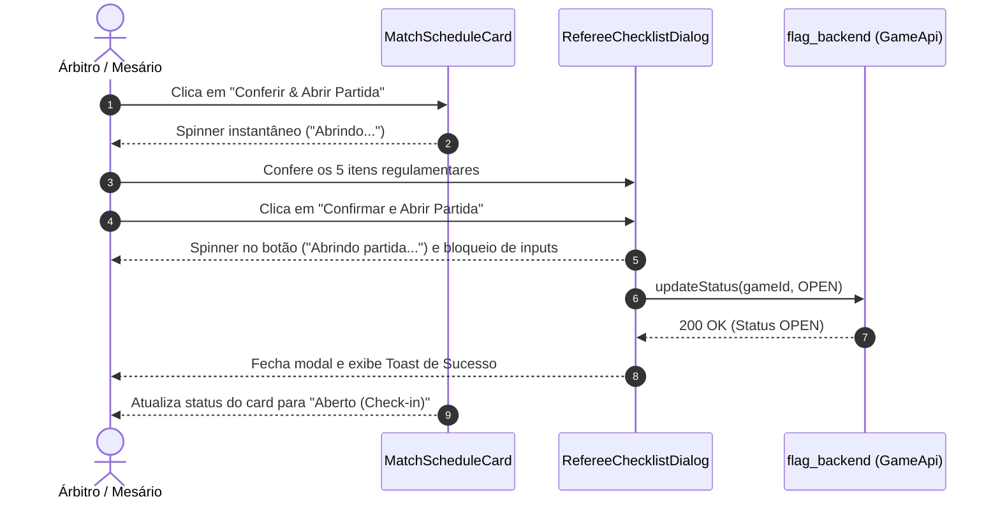

# Fluxo de Abertura de Partida e Check-in Reativo

> **Status:** Aprovado e Implantado em Staging  
> **Data:** Novembro de 2026  
> **Aplicações Envolvidas:** `flag_referee_app`, `flag_backend`  
> **Banco de Dados:** Migration Liquibase 025  

---

## 1. Visão Geral e Motivação

Durante as operações de campo em partidas de Flag Football, a mesa de arbitragem necessita de máxima agilidade para:
1. **Abrir partidas agendadas**: O ato de abrir a partida (`SCHEDULED` -> `OPEN`) envolve a validação dos 5 itens de conformidade do regulamento. Anteriormente, o botão não apresentava feedback imediato ao ser acionado, gerando percepção de inatividade ("congelamento").
2. **Conferência ágil de elencos (Check-in)**: Em elencos com 15 a 30 atletas, verificar presença exigia rolar uma lista extensa repetidamente para encontrar quem ainda faltava.
3. **Identificação instantânea dos atletas**: Atletas frequentemente são chamados pelo apelido ou primeiro nome, e números de camisa podem ter sido cadastrados apenas no elenco-base do time e não no elenco da competição específica.

---

## 2. Arquitetura da Solução

### 2.1. Feedback Visual Imediato na Abertura de Partida

Para eliminar a sensação de atraso:
1. **Home Screen (`MatchScheduleCard`)**:
   - Foi introduzido o estado reativo `openingGameIdProvider = StateProvider<String?>((ref) => null)`.
   - Ao clicar em "Conferir & Abrir Partida", o botão exibe imediatamente estado de carregamento (`loading: true`, rótulo `Abrindo...`) e desabilita cliques concorrentes.
2. **Checklist Regulamentar (`RefereeChecklistDialog`)**:
   - O modal de conformidade recebe o callback `Future<void> Function()? onConfirmOpening`.
   - Ao marcar os 5 itens e clicar em "Confirmar e Abrir Partida", o botão assume estado de loading (`loading: _isSubmitting`, `Abrindo partida...`) e desabilita interações nos checkboxes e botões secundários.
   - A requisição `PATCH /api/v1/games/{id}/status?newStatus=OPEN` é executada dentro do modal; o diálogo só fecha mediante confirmação bem-sucedida da API. Em caso de falha de conexão, uma mensagem de erro Kickster é disparada e o diálogo permanece acessível para nova tentativa.

---

### 2.2. Check-in Reativo com Segregação Pendentes vs Confirmados

Para agilizar a conferência física dos atletas na beira do campo, a lista de atletas relacionados foi dividida dinamicamente em duas seções contíguas:

1. **Área 1 — Aguardando Presença (Pendentes)**:
   - Exibe apenas atletas cujo status seja diferente de `PRESENT` ou `VALIDATED`.
   - Cabeçalho exibe badge de destaque: `${pendingItems.length} restantes`.
   - Conforme o mesário toca no toggle de presença de um atleta, a mutação otimista em 0ms (`setOptimisticStatus`) transfere o atleta instantaneamente para a Área 2, diminuindo visualmente a lista pendente.
   - Quando `pendingItems.isEmpty` e `confirmedItems.isNotEmpty`, a seção exibe um banner verde de sucesso: *"Todos os atletas conferidos! Nenhum atleta pendente de conferência nesta equipe."*
2. **Área 2 — Presença Confirmada (Confirmados)**:
   - Exibe a lista de atletas com presença confirmada.
   - Cabeçalho com badge verde: `${confirmedItems.length} presentes`.
   - Permite que o mesário desmarque a presença com 1 toque caso tenha se enganado; o atleta retorna imediatamente para a Área 1 de Pendentes.

---

### 2.3. Resolução de Apelidos e Numeração a Partir da Base de Dados

#### Diretriz Arquitetural Mandatória:
**O aplicativo móvel (`flag_referee_app`) é puramente apresentacional e NUNCA manipula ou fatia strings para inferir ou inventar apelidos no cliente.** O `nickname` deve vir consolidado diretamente da base de dados / API.

#### Backend (`flag_backend`):
1. **Migration 025 (`025-infer-roster-nickname-and-jersey-numbers.yaml`)**:
   - `nickname`: Atualizado diretamente na base de dados (`team_roster.nickname`) a partir do primeiro nome registrado em `persons.name` (`SUBSTR(name, 1, INSTR(name || ' ', ' ') - 1)` no Oracle / `SPLIT_PART` no H2/PostgreSQL) para todos os registros que estavam nulos.
   - `jersey_number`: Consolidado na base de dados em elencos de competição (`competition_id IS NOT NULL`), herdando do elenco-base (`competition_id IS NULL`) da mesma equipe/atleta quando nulo.
2. **Serviços Backend**:
   - `CheckInService`: Entrega `athleteNickname` diretamente do registro de `team_roster`.
   - `RosterService`: Retorna `nickname` e `number` com herança do elenco base da base de dados quando aplicável.

#### Frontend (`flag_referee_app`):
- `CheckIn` model: Não possui métodos de inferência ou fatiamento de strings. Utiliza `displayName => hasNickname ? athleteNickname!.trim() : athleteName`.
- `AthleteCheckInCard`: Se houver apelido vindo da base de dados, exibe o apelido como título e o nome completo no subtítulo. Se não houver apelido cadastrado na base, exibe diretamente o nome do atleta no título sem manipulação artificial.

---

## 3. Matriz de Conformidade

| Requisito | Status | Verificação |
|-----------|--------|-------------|
| Feedback visual na abertura de jogo | Concluído | Loading nos cards e no modal de abertura com tratamento de erro |
| Segregação pendentes vs confirmados no check-in | Concluído | Lista reativa em 0ms com banner de conclusão |
| Nickname vindo da base de dados | Concluído | Migration 025 grava no banco; app consome sem manipulação de strings |
| Herança de número da camisa | Concluído | Migration 025 + RosterService + fallback `effectiveNumber` |
| Flutter Analyze | 0 erros / 0 avisos | Validado no `flag_referee_app` |
| Governança de Documentação (Regra 6) | Concluído | Registrado e versionado no `flag_platform_docs` |
