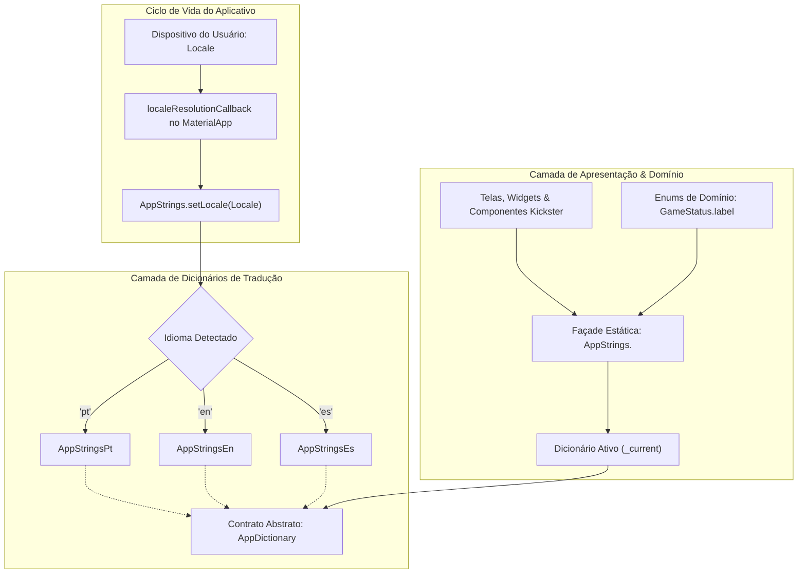

# Padrão de Internacionalização (i18n / l10n) nos Aplicativos Móveis

Este documento estabelece a arquitetura, convenções e regras mandatórias para internacionalização e localização nos aplicativos móveis da plataforma: **`flag_public_app`** (App do Público/Torcedor) e **`flag_referee_app`** (App da Mesa/Árbitro).

---

## 1. Idiomas Oficiais Suportados

Os aplicativos móveis detectam automaticamente o idioma configurado no sistema operacional do dispositivo do usuário, suportando nativamente os seguintes idiomas:

1. **Português (`pt_BR`, `pt`)** — Idioma padrão da plataforma (*fallback*).
2. **Inglês (`en_US`, `en`)** — Localização completa para competições e audiência internacional.
3. **Espanhol (`es_ES`, `es`)** — Localização completa para o público e delegações hispanófonas da América Latina e exterior.

---

## 2. Arquitetura em Camadas (MVVM + Dicionário Dinâmico)

Para garantir desacoplamento, tipagem forte em tempo de compilação e performance nativa sem overhead de parsing lento em runtime, a solução utiliza o padrão **Façade de Dicionário Dinâmico**:



### 2.1 Componentes da Estrutura

- **`lib/config/l10n/app_dictionary.dart`**: Interface/contrato abstrato contendo todos os getters de chaves de texto e funções dinâmicas parametrizadas.
- **`lib/config/l10n/translations/app_strings_pt.dart`**: Implementação das traduções em Português.
- **`lib/config/l10n/translations/app_strings_en.dart`**: Implementação das traduções em Inglês.
- **`lib/config/l10n/translations/app_strings_es.dart`**: Implementação das traduções em Espanhol.
- **`lib/config/l10n/app_strings.dart`**: Façade estática que mantém a referência do dicionário ativo (`_current`) e do locale ativo (`_currentLocale`), expondo os mesmos getters da aplicação.
- **`lib/app.dart`**: Configuração do `MaterialApp.router` com `supportedLocales`, delegados de localização (`flutter_localizations`) e `localeResolutionCallback`.

---

## 3. Integração no `MaterialApp`

Em ambos os aplicativos (`flag_public_app/lib/app.dart` e `flag_referee_app/lib/app.dart`):

```dart
MaterialApp.router(
  title: 'Flag Public App', // ou 'Flag Referee App'
  debugShowCheckedModeBanner: false,
  theme: AppTheme.light,
  supportedLocales: const [
    Locale('pt', 'BR'),
    Locale('pt'),
    Locale('en', 'US'),
    Locale('en'),
    Locale('es', 'ES'),
    Locale('es'),
  ],
  localeResolutionCallback: (deviceLocale, supportedLocales) {
    if (deviceLocale != null) {
      for (final supported in supportedLocales) {
        if (supported.languageCode == deviceLocale.languageCode) {
          AppStrings.setLocale(supported);
          return supported;
        }
      }
    }
    AppStrings.setLocale(const Locale('pt', 'BR'));
    return const Locale('pt', 'BR');
  },
  localizationsDelegates: const [
    GlobalMaterialLocalizations.delegate,
    GlobalWidgetsLocalizations.delegate,
    GlobalCupertinoLocalizations.delegate,
  ],
  routerConfig: router,
);
```

---

## 4. Regras e Boas Práticas de Código

1. **Getters Não-Constantes**:
   - Como os textos são recuperados dinamicamente via `AppStrings.<chave>` conforme o locale ativo, eles **não** são constantes de tempo de compilação (`const`).
   - Portanto, widgets que consom `AppStrings` (como `Text(AppStrings.title)`) não podem ter o prefixo `const` no nó construtor imediato ou na lista pai literal.
   - Folhas estáticas (como `SizedBox(height: 16)` ou `Icon(Icons.star)`) dentro da mesma árvore mantêm seus `const` normalmente para preservar otimizações de renderização.

2. **Enums de Domínio**:
   - Rótulos textuais de enums (ex.: `GameStatus.label`) devem delegar para a camada de l10n via método dedicado (ex.: `AppStrings.gameStatusLabel(this)`), evitando strings hardcoded de exibição dentro das classes de modelo.

3. **Adição de Novas Strings**:
   - Toda nova chave criada deve ser declarada no contrato `AppDictionary` e implementada simultaneamente nos 3 arquivos de idioma (`app_strings_pt.dart`, `app_strings_en.dart`, `app_strings_es.dart`) e na façade `AppStrings`. O compilador do Dart acusará erro caso alguma tradução seja omitida, garantindo cobertura de 100%.

4. **Verificação de Qualidade**:
   - Sempre executar `dart analyze flag_public_app/lib flag_referee_app/lib` e garantir `0 issues found!`.
