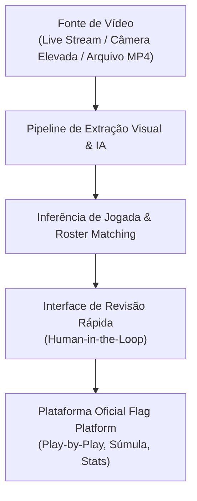
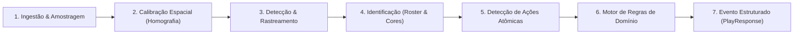

# Especificação Técnica: Modelo de Extração de Dados em Vídeo para Registro de Jogadas

> **Documento Oficial de Arquitetura & Inteligência Visual**  
> **Status:** Proposto / Em Desenho  
> **Aplica-se a:** `flag_platform_docs`, `flag_backend`, `flag_referee_app`, `flag_public_app`  
> **Data:** Novembro de 2026  
> **Tracker:** [`_planning/extracao-video-jogadas/map.md`](../_planning/extracao-video-jogadas/map.md) · ID: `VID-01`

---

## 1. Visão Geral e Motivação

Na operação esportiva atual da Flag Platform, o registro do *Play-by-Play* (jogada a jogada) e da súmula eletrônica é realizado em tempo real por operadores de mesa ou árbitros através do `flag_referee_app`. Embora o aplicativo tenha sido progressivamente otimizado para operação de baixo atrito, o registro humano manual em campo apresenta desafios intrínsecos:
1. **Perda de Detalhes Finos:** Em jogadas rápidas, identificar simultaneamente o passador, recebedor, defensor que retirou a fita (*flag pull*), a jarda exata da queda e as infrações gera sobrecarga cognitiva.
2. **Dependência de Operadores Dedicados:** Nem todos os jogos ou torneios menores contam com operadores de mesa experientes disponíveis.
3. **Existência de Acervo de Vídeo Subutilizado:** A grande maioria dos jogos já é gravada (transmissões ao vivo no YouTube, câmeras táticas elevadas na linha de 50 jardas, gravações de equipes ou smartphones em tripés).

**Objetivo Central:** Desenhar a arquitetura e o modelo de **Extração de Dados em Vídeo para Registro de Jogadas**, transformando filmagens de partidas de Flag Football em fluxos de eventos estruturados do catálogo oficial da Flag Platform, reduzindo a necessidade de anotação manual e enriquecendo as estatísticas oficiais.

---

## 2. Casos de Uso e Modos de Operação



O modelo é projetado para operar em dois modos:

1. **Modo Pós-Jogo (Batch / On-Demand):**
   - Upload de vídeo completo (ou link de transmissão gravada).
   - Processamento assíncrono em nuvem ou cluster GPU.
   - Geração da linha do tempo completa do jogo para validação do delegado/arbitragem com reprodução sincronizada (*clique no evento leva ao timestamp exato do vídeo*).
2. **Modo Em Tempo Real / Near-Real-Time (Live Assist):**
   - Ingestão do stream de vídeo (RTMP / HLS / WebRTC).
   - Detecção de cada jogada individual entre 3 e 10 segundos após o término do lance.
   - O `flag_referee_app` recebe sugestões automáticas na tela: *"Detectado: Passe Completo #7 para #11, avanço de 12 jardas, fita retirada por #24. Confirmar?"*.

---

## 3. Pipeline Arquitetural de Extração Visual

O pipeline divide o problema em camadas bem delimitadas, desde o sinal visual bruto até o evento de domínio:



### 3.1. Ingestão e Pré-processamento
- **Entrada:** Arquivo de vídeo (H.264/H.265) ou Stream RTMP com resolução mínima recomendada de 1080p a 30/60 fps.
- **Segmentação de Lances (Play Slicing):** Identificação dos momentos de bola viva vs. bola morta para não processar tempos ociosos (intervalos, substituições, comemorações).
  - O início do lance é ancorado na formação das equipes e no movimento de *snap*.
  - O término é ancorado na retirada de fita (*flag pull*), passe incompleto no solo, avanço para fora de campo ou apito do árbitro.

### 3.2. Calibração Espacial e Homografia de Campo (2D Mapping)
- **Desafio:** Câmeras com ângulos oblíquos (perspectiva lateral ou diagonal) geram distorções de distância.
- **Solução:** 
  - Detecção automática das linhas demarcatórias do campo (endzones, linhas de 5 jardas, meio de campo, linhas laterais e cones).
  - Matriz de Homografia ($H$) mapeando coordenadas em pixels $(u, v)$ para o plano métrico tático do campo de Flag Football $(x, y)$ em jardas reais:
  $$\begin{bmatrix} x \\ y \\ 1 \end{bmatrix} \sim H \begin{bmatrix} u \\ v \\ 1 \end{bmatrix}$$
  - Permite calcular com precisão métrica: linha de scrimmage de saída, jarda final da jogada e saldo líquido de jardas conquistadas.

### 3.3. Detecção e Rastreamento de Objetos (Detection & Tracking)
- **Detecção:** Identificação frame a frame de:
  - Atletas de ambos os times (`player`).
  - Árbitros (`referee` - camisa listrada).
  - Bola (`ball` - American football).
  - Fitas na cintura (`flags` - cores contrastantes com o short).
- **Rastreamento Temporal (Multi-Object Tracking):** Algoritmos baseados em detecção e reidentificação contínua (ex.: BoT-SORT / ByteTrack) para manter IDs estáveis ao longo de todo o lance.

### 3.4. Reconhecimento de Identidade e Atletas (Roster Matching)
- **Separação de Equipes:** Agrupamento por cor predominante do uniforme via *Color Clustering* (K-Means/HSV no torso dos atletas), segregando automaticamente o Time A do Time B.
- **OCR de Dorsais (Números das Camisas):**
  - Detecção da região do dorsal e peito.
  - OCR especializado com agregação temporal de múltiplos frames para lidar com dobras e oclusões de tecido.
  - Cruzamento com a lista de atletas relacionados na súmula da partida (`game.homeRoster` e `game.awayRoster`).

### 3.5. Detecção de Ações Atômicas (Action Recognition & Pose)
Ações fundamentais que compõem uma jogada de Flag Football:
1. `SNAP`: Movimento de início entre o centralizador e o quarterback.
2. `BALL_RELEASE`: Momento e posição em que a bola sai da mão do passador.
3. `BALL_TRAJECTORY`: Vetor de voo da bola em direção a uma área do campo.
4. `CATCH_SUCCESS`: Recepção completada e posse assegurada antes da saída de campo ou toque no chão.
5. `CATCH_FAIL`: Bola tocando o solo ou saindo de campo sem posse.
6. `FLAG_PULL`: Deslocamento abrupto ou remoção de uma das fitas presas ao cinto do portador da bola.
7. `TOUCHDOWN_ENTRY`: Portador da bola cruzando o plano da linha de gol da endzone adversária com a bola.
8. `REFEREE_SIGNAL`: Reconhecimento de gestos do árbitro de campo (ex.: braços para cima = Touchdown, braços cruzados na altura do peito = Incompleto, mãos na cintura = Impedimento/Falta).

### 3.6. Motor de Regras e Inferência de Jogada
Correlaciona as ações atômicas detectadas com o **Catálogo Oficial de 38 Jogadas da Flag Platform** (definido em [`otimizacao-fluxo-registro-jogadas.md`](otimizacao-fluxo-registro-jogadas.md)):

```
Ações Detectadas:
  [Snap na Jarda 20] + [Passe de #12 para #84 na Jarda 35] + [Flag Pull de #21 na Jarda 38]
Inferência de Domínio:
  Tipo: PASS_COMPLETE (CMP)
  Time em Posse: Mandante
  Passador (QB): #12
  Recebedor (WR): #84
  Defensor (PULL): #21
  Jarda Inicial: 20 -> Jarda Final: 38 (+18 jardas)
  Resultado: 1ª Descida Conquistada (FIRST_DOWN)
```

---

## 4. Esquema de Dados do Evento Extraído

A saída da extração visual é formatada no padrão exato consumido pelo backend da Flag Platform:

```json
{
  "gameId": "b18a28f5-303a-4467-96bf-bc5d3f2ea4d1",
  "source": "VIDEO_AI_INFERENCE",
  "confidenceScore": 0.94,
  "videoMetadata": {
    "videoUrl": "https://pub.america.app.br/videos/2026/game-b18a28f5.mp4",
    "timestampStartMs": 142300,
    "timestampEndMs": 151800,
    "thumbnailUrl": "https://pub.america.app.br/videos/2026/thumbs/play-042.jpg"
  },
  "play": {
    "playType": "PASS_COMPLETE",
    "possessionTeamId": "f784d09c-e366-4d15-8fa1-01639d6b9d88",
    "quarter": 2,
    "down": 2,
    "distanceToFirstDown": 15,
    "fieldPosition": 20,
    "targetYard": 38,
    "netYards": 18,
    "isFirstDown": true,
    "isTurnover": false,
    "primaryAthlete": {
      "number": 84,
      "role": "RECEIVER",
      "athleteId": "e2381289-450a-4122-bd12-bb207869aa41"
    },
    "passerAthlete": {
      "number": 12,
      "role": "PASSER",
      "athleteId": "c9284091-bb21-4192-9111-a8b291048821"
    },
    "defensiveAthlete": {
      "number": 21,
      "role": "FLAG_PULLER",
      "athleteId": "a1847192-8821-4b10-9831-aa9837162981"
    }
  }
}
```

---

## 5. Abordagens Tecnológicas e Stack Candidata

| Componente | Opção Especializada (Modular) | Opção Multimodal (Video-LLM) | Abordagem Híbrida Recomendada |
|---|---|---|---|
| **Corte de Jogadas (Slicing)** | Detecção de movimento óptico + apito de áudio | Segmentação temporal de vídeo com Gemini Flash | **Híbrida:** Modelo leve de áudio/movimento corta lances; LLM analisa os recortes |
| **Calibração de Campo** | OpenCV Keypoints + Homografia RANSAC | Estimativa aproximada via prompt de coordenadas | **Especializada:** Homografia matemática geométrica para precisão exata de jardas |
| **Detecção de Atletas & Bola** | YOLOv11 / RT-DETR + BoT-SORT | Tokens visuais integrados no VLM | **Híbrida:** YOLOv11 rastreia posições e coordenadas; VLM interpreta o contexto |
| **Identificação dos Jogadores** | PaddleOCR / TrOCR no dorsal | Reconhecimento visual multimodal com base na súmula | **Híbrida:** Detecção OCR assistida pela lista fechada de números do roster da partida |
| **Classificação da Jogada** | Máquina de Estados Finita (FSM) baseada em regras | Ingestão do clipe no Gemini 2.0 Flash com catálogo de jogadas | **Multimodal:** O VLM recebe o clipe curto (8s) + contexto e emite o JSON estruturado |

---

## 6. Governança e Human-in-the-Loop (Interface de Revisão)

A inteligência visual atua como **copiloto / assistente** da arbitragem e da organização:

1. **Indicador de Confiança:** Cada jogada possui um `confidenceScore` (0.00 a 1.00). Jogadas com confiança acima de 90% podem ser auto-aprovadas em modo batch ou pré-selecionadas na tela de conferência.
2. **Player Sincronizado:** O operador ou delegado assiste aos lances com bounding boxes opcionais e confirma com 1 clique.
3. **Loop de Realimentação (Fine-Tuning Ativo):** Correções manuais de números de camisas ou tipos de jogada geram anotações rotuladas para melhoria contínua dos modelos de visão.

---

## 7. Fases do Roadmap do Esforço (`VID`)

1. **VID-01:** Desenho arquitetural, esquema de dados e definição do pipeline (este documento).
2. **VID-02:** Dataset de calibração e filmagens de referência (Flag Football 5x5 / 8x8 nacional).
3. **VID-03:** Prova de Conceito (PoC) de segmentação de lances e homografia de campo (pixels -> jardas).
4. **VID-04:** PoC de identificação de atletas (OCR dorsal + cor do uniforme vs. roster oficial).
5. **VID-05:** Pipeline multimodal de inferência de jogadas (clipe curto -> `PlayResponse` JSON).
6. **VID-06:** Interface de revisão no `flag_admin_web` / `flag_referee_app` com player sincronizado.
