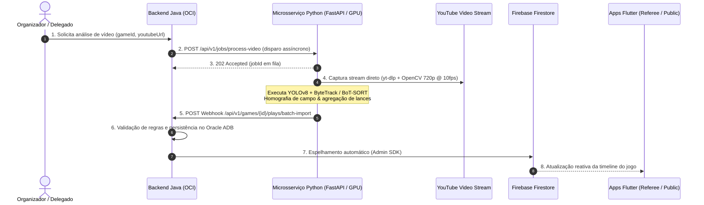
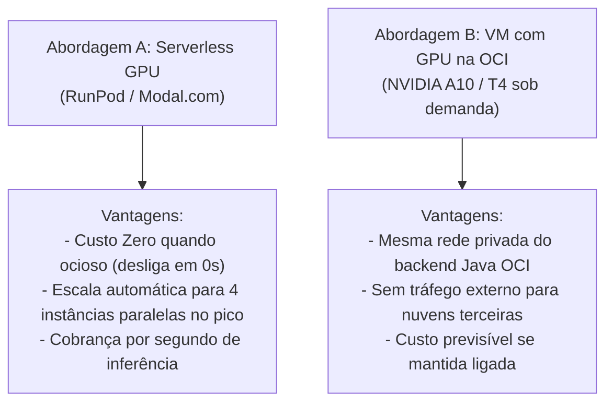

# Especificação Técnica: Modelo de Extração de Dados em Vídeo para Registro de Jogadas

> **Documento Oficial de Arquitetura & Inteligência Visual**  
> **Status:** Proposto / Em Desenho (Fase 0 - Batch/Pós-Jogo)  
> **Aplica-se a:** `flag_platform_docs`, `flag_backend`, `flag_referee_app`, `flag_public_app`, `flag_vision_service` (novo microsserviço)  
> **Data:** Novembro de 2026  
> **Tracker:** [`_planning/extracao-video-jogadas/map.md`](../_planning/extracao-video-jogadas/map.md) · IDs: `VID-01`, `VID-02`, `VID-03`

---

## 1. Visão Geral e Arquitetura do Sistema Atual

A Flag Platform opera hoje em uma topologia híbrida de alta performance:
1. **Backend Principal:** Aplicação Java (Spring Boot) em Máquina Virtual na Oracle Cloud Infrastructure (OCI), responsável pelas regras de negócio oficiais, autenticação e banco relacional de produção (Oracle Autonomous Database 23ai).
2. **Portal Web Administrativo:** Desenvolvido em Flutter Web e distribuído globalmente via Cloudflare (Pages / CDN).
3. **Aplicativos Móveis (2x):**
   - [`flag_referee_app`](../../flag_referee_app): Operação de mesa, cronômetro oficial e súmula eletrônica.
   - [`flag_public_app`](../../flag_public_app): Acompanhamento público em tempo real para torcedores e atletas.
4. **Espelhamento em Tempo Real:** Sincronização automática do backend Java com o **Firebase Firestore**, permitindo aos apps Flutter reagirem instantaneamente aos eventos de jogo.

---

## 2. Fase 0: Processamento em Lote Pós-Jogo (Batch Processing)

O objetivo prioritário da Fase 0 é automatizar a extração tática de partidas já gravadas disponíveis no YouTube:



### Principais Diretrizes da Fase 0:
- **Consumo Direto de Stream (Sem Download em Disco):** Análise do fluxo de vídeo diretamente da URL do YouTube usando `yt-dlp` combinado com `OpenCV` (`cv2.VideoCapture`), eliminando a necessidade de armazenar arquivos brutos de 2h (~2GB a 6GB) no disco do servidor.
- **Volume e Concorrência:** Capacidade para gerenciar filas com pico de até **4 vídeos simultâneos** em processamento.
- **Otimização de Performance e Custo:**
  - Amostragem reduzida para **10 FPS** (taxa ideal para rastreamento de futebol americano/flag sem redundância temporal).
  - Resolução travada em **720p HD** (equilíbrio perfeito entre clareza para leitura de dorsais/fitas e consumo de VRAM da GPU).

---

## 3. Stack Tecnológica de IA (100% Open-Source / Free Software)

| Camada | Tecnologia | Função e Justificativa |
|---|---|---|
| **API do Microsserviço** | **Python (FastAPI)** | Assíncrono, leve e padrão da indústria para servir modelos de Machine Learning. |
| **Captura de Stream** | **yt-dlp + OpenCV** | Extrai a URL direta do stream de vídeo H.264/DASH em memória e alimenta `cv2.VideoCapture`. |
| **Engine de Visão Computacional** | **Ultralytics YOLOv8** | Modelos `yolov8n` (Nano) ou `yolov8s` (Small) para balancear altíssima velocidade e consumo mínimo de GPU. |
| **Rastreamento Multi-Objeto (MOT)** | **ByteTrack / BoT-SORT** | Nativos do ecossistema Ultralytics; preservam os IDs dos atletas frame a frame mesmo sob oclusões. |
| **Calibração Espacial** | **OpenCV (Homografia)** | Conversão matemática das coordenadas em pixels $(u, v)$ para a posição métrica do campo $(x, y)$ em jardas. |
| **Comunicação Inter-serviços** | **HTTP Webhooks (JSON)** | Desacoplamento total: Java notifica o início e Python devolve os eventos processados. |

---

## 4. Contrato de Comunicação entre Java e Python

### 4.1. Disparo de Processamento (Java $\to$ Python)
`POST https://vision.america.app.br/api/v1/jobs/process-video`

```json
{
  "gameId": "b18a28f5-303a-4467-96bf-bc5d3f2ea4d1",
  "youtubeUrl": "https://www.youtube.com/watch?v=dQw4w9WgXcQ",
  "webhookCallbackUrl": "https://api.america.app.br/api/v1/games/b18a28f5-303a-4467-96bf-bc5d3f2ea4d1/plays/batch-import",
  "gameContext": {
    "modality": "FLAG_5X5",
    "homeTeam": {
      "id": "team-001",
      "name": "São Paulo Spartans",
      "primaryColor": "#001F5B",
      "rosterNumbers": [7, 11, 12, 21, 24, 84]
    },
    "awayTeam": {
      "id": "team-002",
      "name": "Rio Sharks",
      "primaryColor": "#FFFFFF",
      "rosterNumbers": [1, 3, 10, 15, 22, 99]
    }
  },
  "options": {
    "samplingFps": 10,
    "resolution": "720p",
    "trackBall": true
  }
}
```

### 4.2. Resposta Imediata da Fila (Python $\to$ Java)
`Status: 202 Accepted`

```json
{
  "jobId": "job-vision-78f921e0",
  "gameId": "b18a28f5-303a-4467-96bf-bc5d3f2ea4d1",
  "status": "QUEUED",
  "estimatedQueueTimeSeconds": 45,
  "createdAt": "2026-11-07T15:15:00Z"
}
```

### 4.3. Retorno Assíncrono via Webhook (Python $\to$ Java)
`POST {webhookCallbackUrl}`

```json
{
  "jobId": "job-vision-78f921e0",
  "gameId": "b18a28f5-303a-4467-96bf-bc5d3f2ea4d1",
  "status": "COMPLETED",
  "summary": {
    "totalPlaysDetected": 48,
    "averageConfidence": 0.92,
    "processingTimeSeconds": 312
  },
  "plays": [
    {
      "sequenceNumber": 1,
      "playType": "PASS_COMPLETE",
      "timestampStartMs": 142000,
      "timestampEndMs": 149500,
      "possessionTeamId": "team-001",
      "down": 1,
      "fieldPosition": 20,
      "targetYard": 35,
      "netYards": 15,
      "isFirstDown": true,
      "isTurnover": false,
      "passerNumber": 7,
      "receiverNumber": 11,
      "flagPullerNumber": 22,
      "confidence": 0.94
    }
  ]
}
```

---

## 5. Estratégia de Infraestrutura e Custos de GPU

Para processar até 4 vídeos simultâneos sem manter custos fixos ociosos, são avaliadas duas abordagens:



### Comparativo Econômico e Operacional:

1. **Abordagem A: Serverless GPU (Modal.com ou RunPod Serverless):**
   - **Modelo de Custo:** Pagamento estritamente por segundo de GPU utilizada (ex.: ~US$ 0,20 a 0,40 por hora de GPU NVIDIA T4/L4).
   - **Comportamento em Pico:** Quando 4 vídeos chegam de uma vez, o provedor instancia 4 containers paralelos automaticamente. Cada vídeo de 2h a 10 FPS demora cerca de 10 a 15 minutos para ser analisado.
   - **Recomendação:** Ideal para a **Fase 0**, pois torneios ocorrem em fins de semana e a infraestrutura permanece com custo **zero** de segunda a sexta.

2. **Abordagem B: Instância OCI com GPU sob Demanda (NVIDIA A10 / T4):**
   - **Modelo de Custo:** Cobrança por hora de VM ativa na OCI.
   - **Gestão:** O backend Java pode usar a OCI CLI/SDK para ligar a VM quando um lote de vídeos for submetido e desligá-la ao término da fila de processamento.

---

## 6. Pipeline de Implementação do Microsserviço Python

O repositório do serviço (`flag_vision_service`) será estruturado com:

```
flag_vision_service/
├── app/
│   ├── api/
│   │   ├── endpoints.py        # Endpoints FastAPI (/process-video, /health)
│   │   └── webhooks.py         # Cliente HTTP de envio de callbacks para o Java
│   ├── core/
│   │   ├── config.py           # Configurações de fila, concorrência e chaves
│   │   └── youtube_stream.py   # Wrapper yt-dlp + cv2.VideoCapture sem download
│   ├── vision/
│   │   ├── yolo_detector.py    # YOLOv8 (detecção de atletas, bola, árbitro)
│   │   ├── tracker.py          # ByteTrack / BoT-SORT
│   │   ├── field_calibrator.py # Homografia de campo (pixels -> jardas)
│   │   └── play_inferer.py     # Agregação temporal de lances e regras de domínio
│   └── main.py                 # Ponto de entrada FastAPI com Uvicorn
├── Dockerfile                  # Base NVIDIA CUDA / PyTorch
├── requirements.txt            # fastapi, uvicorn, ultralytics, yt-dlp, opencv-python
└── README.md
```

---

## 7. Próximos Passos Imediatos (`VID-01` $\to$ `VID-03`)

1. **VID-01:** Concluir e aprovar este desenho de arquitetura.
2. **VID-02:** Criação do repositório base `flag_vision_service` com FastAPI, leitor `yt-dlp` em stream e YOLOv8 Nano.
3. **VID-03:** Teste de bancada com URL real de jogo no YouTube para aferir FPS, precisão de tracking e consumo de memória.
